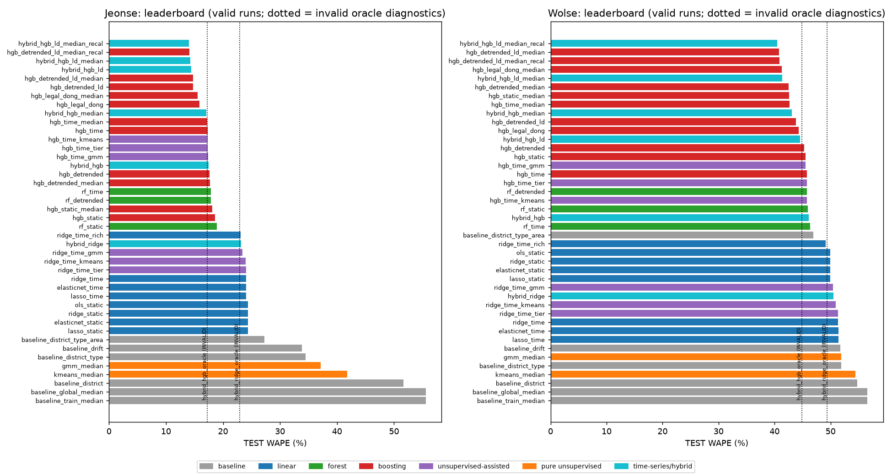
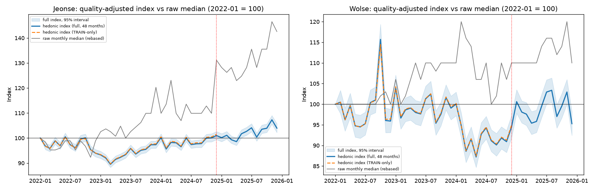
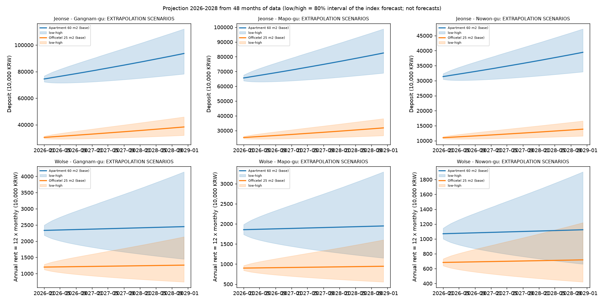

# Seoul Rental Market: How Much Will a Tenant Pay in the Coming Years?

End-to-end data science project on 387,326 cleaned Seoul rental contracts (2022-2025): leakage-safe EDA and modeling of **Jeonse** (deposit-only) and **Wolse** (monthly rent) contracts, 42 valid models compared per track (baselines, linear, forests, boosting, K-Means, hierarchical clustering, Gaussian mixtures, time series and a hybrid), a quality-adjusted price index, and clearly labelled 2026-2028 extrapolation scenarios.

## Key results

- **Selected model for each track** (chosen on the 2023-2024 pseudo-tests with settings tuned inside each fit window, then evaluated once on 2025): `hgb_detrended_ld_median_recal` for Jeonse (WAPE 14.14%) and `hgb_detrended_ld_median` for Wolse (WAPE 40.80%). Requiring extrapolation costs 0.0000 (Jeonse) and 0.0000 (Wolse) WAPE points against the unconstrained choice, which is the same model in each track and extrapolates.
- **Against the first protocol** (selection on the 2025 error, no neighbourhood in the trend-aware models): the 2025 WAPE falls from 15.84% (Jeonse, `hgb_legal_dong`) and 44.33% (Wolse, `hgb_legal_dong`) to 14.14% and 40.80%.
- **Components, on 2025 (notebook 11).** For the detrended model the grouped neighbourhood changes the WAPE by -2.8956 points in Jeonse (17.6481% to 14.7525%) and -1.4888 in Wolse; the median loss on top of it changes it by -0.0159 (Jeonse) and -3.0454 (Wolse); the recalibration by -0.6000 and 0.0564. The neighbourhood is the main gain in Jeonse and the median loss (the log of the Wolse rent is left-skewed, skewness -0.4006) is the main gain in Wolse.
- **Raw monthly medians mislead.** The quality-adjusted index ends 2025 at 103.96 (Jeonse) and 95.28 (Wolse), while the raw monthly median rebased to 2022-01 reaches 142.58 and 110.00: most of the apparent rise is a change in the sample mix.
- **Supervised beats unsupervised.** Boosting and the hybrid (structure model plus index) are the best families in both tracks; unsupervised features add little or nothing to boosting, and pure unsupervised predictors are the weakest family.
- **Prediction intervals (notebook 12).** Split conformal intervals for a single contract (calibrated on the last 6 months of the fit window, on the `log1p` scale) cover 0.8186 and 0.9595 of the 2025 contracts in Jeonse and 0.8095 and 0.9542 in Wolse at the 80% and 95% levels, close to nominal. Coverage is not uniform: Jeonse detached houses are covered 0.5582 at the 80% level, and the Wolse pseudo-test of 2024 covers only 0.7504 (unscaled) because the error scale grew after the calibration window. The Wolse intervals are wide (median relative width 1.6647 of the prediction for the 80% unscaled interval).
- **The 2026-2028 numbers are extrapolation scenarios, not forecasts**: they extrapolate 48 months of data. Both selected models extrapolate (they are not level-persistence models).



## Business question

How much will a tenant pay in Seoul in the coming years? The answer differs by contract type: a **Jeonse** tenant pays a large lump-sum deposit and no monthly rent, while a **Wolse** tenant pays a smaller deposit plus monthly rent. The two are modeled separately, because pooled deposits mix both types. The annual cash cost is the deposit for Jeonse and 12 x the monthly rent for Wolse.

## Data

- **Source:** Seoul Open Data Plaza, "Seoul Real Estate Jeonse and Monthly Rent Price Information" (OA-21276), file `data/Seoul_Rentals_2022_2025.csv`.
- **Sample design:** 400,000 rows x 23 columns, with about 100,000 records per year (2022-2025). It is a sample and **not proportional to the market**, so counts per month or per year are not market volume.
- **Units:** money columns are in units of 10,000 KRW (a deposit of 16,000 means 160,000,000 KRW); area is in m2.
- **Contract type:** `lease_type` is `Jeonse (deposit only)` or `Monthly rent`; it was inferred from `monthly_rent == 0` in 2022, 2024 and 2025.

**Cleaning (documented in `Notebook.ipynb`; every dropped row is counted):**

| Step | Rows dropped | Rows left |
|---|---:|---:|
| Raw file | - | 400,000 |
| Exact duplicates | 10 | |
| Missing `year_built` (12,650 missing in the raw file) | | 387,342 |
| Partial month (contracts from 2026-01-01) | 11 | 387,331 |
| Impossible `year_built` (outside 1850-2026) | 4 | 387,327 |
| Impossible `floor` (above 100; one row with floor 302) | 1 | 387,326 |

In total 12,674 rows (3.17%) were dropped and 96.83% were retained: 176,783 Jeonse and 210,543 Wolse contracts. Price and area outliers are real market values and are **kept** (log transforms are used instead); only impossible values were removed, with domain-based ranges.

## Methodology

1. **EDA** (`Notebook.ipynb`): distributions, data quality, bivariate and temporal analysis, using medians for skewed variables and separate Jeonse / Wolse comparisons.
2. **Strict temporal split.** TRAIN is 2022-01-01 to 2024-12-31 (138,848 Jeonse and 152,714 Wolse rows) and TEST is 2025 (37,935 and 57,829 rows). Never a random split. Tuning uses a 3-fold expanding-window time CV inside TRAIN.
3. **Leakage controls.** Scaling, encoding, imputation, clustering and hyperparameters are fit on TRAIN only; the deposit is never a feature of the Wolse track; `monthly_rent`, every `previous_*` column, contract dates and period columns, lot numbers and `row_id` are forbidden (enforced by tests); the target never builds cluster features.
4. **Features:** `district_name`, `building_type`, `contract_type`, `renewal_right_used`, `log_area`, `floor` (with a missing flag), `building_age`, seasonality and time index `t` only in the "time" variants, and an optional neighbourhood (`legal_dong` within district).
5. **Target:** `log1p(target)`, back-transformed with `expm1`. **Primary metric: WAPE** (also MAE, MdAPE, median and aggregate bias, RMSE and R2 on the log scale, and MAPE by district x quarter).
6. **Models compared** (notebooks `01` to `08`, the median-loss variants of notebook `10` and the neighbourhood-aware trend models of notebook `11`: `hgb_detrended_ld` and `hybrid_hgb_ld`, with median loss and a recalibrated version): naive baselines (global, district, district x type, + area quintile, last-year drift); OLS, Ridge, Lasso and Elastic Net (static and time variants, plus interactions); Random Forest (static, time, detrended); HistGradientBoosting (static, time, detrended, neighbourhood); K-Means, Ward clustering of districts and Gaussian mixtures, used as pure predictors and as features; a quality-adjusted (hedonic time-dummy) price index forecast with naive, drift, ETS, ARIMA, SARIMA and Theta; and a **hybrid** that adds a forecasted index to a structure model without time.
7. **Selection rule** (`notebooks 11, 10 and 09`, `CLAUDE.md` rule 8): candidates are compared on two rolling-origin pseudo-tests (fit before 2023 and test 2023; fit before 2024 and test 2024), with settings chosen by 3-fold time CV inside each fit window. The rule is a one-standard-error rule on the pooled pseudo-test WAPE using the **largest of the row, month-block and district-block bootstrap standard errors**; ties go to the model with fewer parameters, then to the smaller absolute aggregate bias. The winner must **behave** as an extrapolating model: its projected path for a fixed profile over 2026-2028 must change beyond the last level (otherwise it is labelled level persistence). Runs that use TEST information (oracle diagnostics) are excluded.
8. **2025 is the final report year.** The selected models are evaluated once on 2025 and no 2025 row selects among the candidates (assertions in notebooks 10 and 11 check this, also for the neighbourhood grouping, the tuning and the recalibration). Disclosure: the 2025 results were inspected in earlier iterations of this project, before the selection protocol was amended; the pseudo-tests remove that influence from the current choice, but the candidate list comes from those earlier iterations. The earlier candidates keep the settings saved by their notebooks; the neighbourhood-aware models are tuned inside each fit window (12 candidates of a random search over the whole fit window, 3-fold expanding-window CV).

## Results

The WAPE, bias and rank columns are the 2025 hold-out and are descriptive: they did not select the models. The pseudo-test column is the pooled 2023-2024 WAPE of the candidates that did (44 models x 2 tracks = 88 runs; 84 valid and 4 oracle diagnostics excluded). Full table: `reports/metrics/leaderboard.csv`.

### Jeonse (target: deposit)

| Rank | Model | Family | WAPE % | Median bias % | Aggregate bias % | Pseudo-test WAPE % | Handles time | Note |
|---:|---|---|---:|---:|---:|---:|---|---|
| 1 | `hybrid_hgb_ld_median_recal` | time-series/hybrid | 14.01 | 2.55 | 1.00 | 15.31 | forecasted index |  |
| 2 | `hgb_detrended_ld_median_recal` | boosting | 14.14 | 2.35 | 1.07 | 15.09 | log-linear trend | chosen and unconstrained choice |
| 3 | `hybrid_hgb_ld_median` | time-series/hybrid | 14.23 | -2.03 | -3.51 | 15.51 | forecasted index |  |
| 4 | `hybrid_hgb_ld` | time-series/hybrid | 14.45 | -3.11 | -4.35 | 15.51 | forecasted index |  |
| 5 | `hgb_detrended_ld_median` | boosting | 14.74 | 5.91 | 4.59 | 16.34 | log-linear trend |  |
| 6 | `hgb_detrended_ld` | boosting | 14.75 | 5.27 | 4.08 | 15.70 | log-linear trend |  |
| 7 | `hgb_legal_dong_median` | boosting | 15.54 | -6.36 | -7.70 | 16.60 | none |  |
| 8 | `hgb_legal_dong` | boosting | 15.84 | -7.37 | -8.57 | 16.38 | none |  |
| 9 | `hybrid_hgb_median` | time-series/hybrid | 17.09 | -2.15 | -3.93 | 17.95 | forecasted index |  |
| 10 | `hgb_time_median` | boosting | 17.22 | -2.53 | -3.52 | 17.34 | time feature in trees (flat beyond 2024) |  |
| 23 | `ridge_time_rich` | linear | 23.09 | -8.26 | -10.61 | 23.29 | linear time feature |  |
| 35 | `baseline_district_type_area` | baseline | 27.25 | -4.76 | -10.29 | 26.36 | none |  |

### Wolse (target: monthly rent)

| Rank | Model | Family | WAPE % | Median bias % | Aggregate bias % | Pseudo-test WAPE % | Handles time | Note |
|---:|---|---|---:|---:|---:|---:|---|---|
| 1 | `hybrid_hgb_ld_median_recal` | time-series/hybrid | 40.44 | 4.29 | 1.02 | 41.19 | forecasted index |  |
| 2 | `hgb_detrended_ld_median` | boosting | 40.80 | -5.76 | -8.73 | 39.23 | log-linear trend | chosen and unconstrained choice |
| 3 | `hgb_detrended_ld_median_recal` | boosting | 40.85 | -6.13 | -9.09 | 39.22 | log-linear trend |  |
| 4 | `hgb_legal_dong_median` | boosting | 41.31 | -6.49 | -9.57 | 39.75 | none |  |
| 5 | `hybrid_hgb_ld_median` | time-series/hybrid | 41.38 | -8.79 | -11.65 | 39.83 | forecasted index |  |
| 6 | `hgb_detrended_median` | boosting | 42.48 | -6.10 | -10.23 | 40.18 | log-linear trend |  |
| 7 | `hgb_static_median` | boosting | 42.58 | -6.81 | -11.03 | 40.38 | none |  |
| 8 | `hgb_time_median` | boosting | 42.67 | -4.96 | -9.15 | 40.71 | time feature in trees (flat beyond 2024) |  |
| 9 | `hybrid_hgb_median` | time-series/hybrid | 43.05 | -9.58 | -13.69 | 40.72 | forecasted index |  |
| 10 | `hgb_detrended_ld` | boosting | 43.84 | -15.76 | -20.41 | 40.85 | log-linear trend |  |
| 23 | `baseline_district_type_area` | baseline | 46.96 | -7.41 | -14.58 | 45.42 | none |  |
| 24 | `ridge_time_rich` | linear | 49.10 | -20.28 | -28.97 | 46.16 | linear time feature |  |

### Winner

- **Jeonse: `hgb_detrended_ld_median_recal`**: boosting with a median loss on the detrended target (log-linear trend added back), the grouped neighbourhood feature and one global scale factor estimated on the last CV fold of the fit window. WAPE 14.14%, median bias 2.35%, aggregate bias 1.07%. The unconstrained choice `hgb_detrended_ld_median_recal` has 14.14% (difference 0.0000 points, 95% bootstrap interval 0.0000 to 0.0000): the model that wins without the extrapolation requirement already extrapolates. The previous choices, `hybrid_hgb` and `rf_detrended`, were a level-persistence model and a model without neighbourhood.
- **Wolse: `hgb_detrended_ld_median`**: boosting with a median loss on the detrended target (trend added back) and the grouped neighbourhood feature. WAPE 40.80%, median bias -5.76%, aggregate bias -8.73%. The unconstrained choice `hgb_detrended_ld_median` has 40.80% (difference 0.0000 points, interval 0.0000 to 0.0000); its recalibrated version ties on the pseudo-tests and loses the tie because it has one more component.
- **What changed** (2025 WAPE, reported after the choice): Jeonse `hgb_legal_dong` 15.84% and `hybrid_hgb` 17.44% (first protocol), `rf_detrended` 17.91% (notebook 10), now 14.14%; Wolse `hgb_legal_dong` 44.33% and `hgb_detrended` 45.33% (first protocol), `hgb_legal_dong_median` 41.31% and `hgb_detrended_median` 42.48% (notebook 10), now 40.80%. All four winners changed; notebook 09 lists the changes.
- **Both selected models extrapolate**: the annual mean of their projected path for a fixed profile changes by 15.0132% (Jeonse) and 0.9595% (Wolse) between 2026 and 2028, so the scenarios below are not level-persistence results.
- **Repeat units are easier than new units** (2025 WAPE of the selected models): Jeonse 12.4268% for repeat units and 15.2375% for new units, Wolse 35.5252% and 43.2485% (the unit key is an approximation; part of the rows have no lot number).

### Supervised vs unsupervised

| Family | Jeonse best model | Jeonse WAPE % | Wolse best model | Wolse WAPE % |
|---|---|---:|---|---:|
| boosting | `hgb_detrended_ld_median_recal` | 14.14 | `hgb_detrended_ld_median` | 40.80 |
| unsupervised-assisted | `hgb_time_kmeans` | 17.34 | `hgb_time_gmm` | 45.56 |
| forest | `rf_time` | 17.91 | `rf_detrended` | 45.76 |
| time-series/hybrid | `hybrid_hgb_ld_median_recal` | 14.01 | `hybrid_hgb_ld_median_recal` | 40.44 |
| linear | `ridge_time_rich` | 23.09 | `ridge_time_rich` | 49.10 |
| baseline | `baseline_district_type_area` | 27.25 | `baseline_district_type_area` | 46.96 |
| pure unsupervised | `gmm_median` | 37.10 | `gmm_median` | 51.87 |

Unsupervised features added to a supervised model (change of the WAPE against the same model without them; negative is better):

| Model | vs | Jeonse WAPE change (points) | Wolse WAPE change (points) |
|---|---|---:|---:|
| `ridge_time_gmm` | `ridge_time` | -0.65 | -0.90 |
| `ridge_time_kmeans` | `ridge_time` | -0.07 | -0.38 |
| `ridge_time_tier` | `ridge_time` | -0.00 | -0.00 |
| `hgb_time_gmm` | `hgb_time` | +0.07 | -0.18 |
| `hgb_time_kmeans` | `hgb_time` | +0.03 | +0.04 |
| `hgb_time_tier` | `hgb_time` | +0.04 | +0.00 |

Supervised boosting wins. Cluster, tier and mixture features do not help boosting beyond bootstrap noise (the only gain is `hgb_time_gmm` in Wolse), help ridge a little, and pure unsupervised predictors (`kmeans_median`, `gmm_median`) are the weakest family. The unsupervised analyses are still useful to describe market segments (see notebooks `05` and `06`).

### Quality-adjusted price index

A hedonic time-dummy index (month coefficients of a regression on structural controls, rebased to 100 at 2022-01) removes the composition effect of a non-proportional sample. At 2025-12 it is 103.96 (Jeonse) and 95.28 (Wolse), against 142.58 and 110.00 for the raw median rebased. See `notebooks/07_price_index_forecasting.ipynb`.



### Scenarios 2026-2028 (extrapolation, not forecasts)

The chosen model of each track is refit on 2022-2025. The base scenario is its projection; low and high scale it by the 80% interval of the index forecast. **They extrapolate only 48 months of data and are not forecasts.** For a model with the neighbourhood feature the base path is the weighted median of its predictions over the neighbourhoods of the district and building type (weights = share of the contracts of 2025). Values are in units of 10,000 KRW (1,000 = 10 million KRW); Jeonse is the deposit, Wolse is the annual rent (12 x monthly rent) while the observed median is the monthly rent. The Wolse cost excludes the deposit.

**Jeonse (deposit):**

| Profile | Observed 2025 median | Comparable contracts | 2026 base (low - high) | 2026 base vs observed % | 2028 base (low - high) |
|---|---:|---:|---:|---:|---:|
| Apartment 60 m2, Gangnam-gu | 73,000.0 | 164 | 77,221.8 (71,759.5 - 83,141.4) | 5.8 | 90,353.4 (76,567.3 - 106,631.2) |
| Apartment 60 m2, Mapo-gu | 54,117.5 | 240 | 68,060.5 (63,246.2 - 73,277.9) | 25.8 | 79,634.3 (67,483.7 - 93,981.0) |
| Apartment 60 m2, Nowon-gu | 28,000.0 | 419 | 32,529.8 (30,228.8 - 35,023.5) | 16.2 | 38,061.6 (32,254.1 - 44,918.8) |
| Officetel 25 m2, Gangnam-gu | 24,500.0 | 44 | 31,598.1 (29,363.0 - 34,020.4) | 29.0 | 36,971.5 (31,330.3 - 43,632.2) |
| Officetel 25 m2, Mapo-gu | 22,000.0 | 33 | 26,232.8 (24,377.2 - 28,243.8) | 19.2 | 30,693.8 (26,010.4 - 36,223.6) |
| Officetel 25 m2, Nowon-gu | 23,500.0 | 2 | 11,419.5 (10,611.7 - 12,294.9) | -51.4 | 13,361.5 (11,322.7 - 15,768.8) |

**Wolse (annual rent):**

| Profile | Observed 2025 median | Comparable contracts | 2026 base (low - high) | 2026 base vs observed % | 2028 base (low - high) |
|---|---:|---:|---:|---:|---:|
| Apartment 60 m2, Gangnam-gu | 200.0 | 191 | 2,351.1 (1,979.3 - 2,801.5) | -2.0 | 2,430.8 (1,523.7 - 3,878.9) |
| Apartment 60 m2, Mapo-gu | 140.0 | 159 | 1,870.9 (1,574.7 - 2,229.8) | 11.4 | 1,934.4 (1,211.6 - 3,088.3) |
| Apartment 60 m2, Nowon-gu | 90.0 | 268 | 1,078.2 (906.7 - 1,286.0) | -0.2 | 1,115.0 (696.5 - 1,783.1) |
| Officetel 25 m2, Gangnam-gu | 80.0 | 276 | 1,210.5 (1,018.2 - 1,443.5) | 26.1 | 1,251.7 (782.4 - 2,000.9) |
| Officetel 25 m2, Mapo-gu | 73.0 | 235 | 907.5 (762.8 - 1,082.7) | 3.6 | 938.5 (585.5 - 1,502.0) |
| Officetel 25 m2, Nowon-gu | 58.0 | 29 | 688.8 (578.6 - 822.4) | -1.0 | 712.5 (443.4 - 1,141.9) |

For example, the 2026 base for an Apartment of 60 m2 in Gangnam-gu is 772.2 million KRW of Jeonse deposit. The Officetel of 25 m2 in Nowon-gu in Jeonse is supported by only 2 comparable contracts in 2025 and should not be relied on.



**Contract-level interval next to the index band.** The low/high scenarios above describe the uncertainty of the price level only. Notebook 09 adds the conformal interval of a single contract (calibration window 2025-07-01 to 2025-12-01) and an assumptions table; for the 60 m2 apartment in Gangnam-gu the Jeonse base of 2026 is 77,221.7735, the index band 71,759.4521 to 83,141.4203 and the 80% interval of one contract 60,656.1125 to 98,311.5719. The two bands are not added and neither is a forecast interval.

## Renewal-only study (separate product)

This section is a **separate product** and is not part of the market models, the leaderboard or the 2026-2028 projection. The question is *what will a tenant pay on a future renewal, given the current price?* It uses the previous price (`previous_deposit_10k_krw` for Jeonse, `previous_monthly_rent_10k_krw` for Wolse), which the modeling protocol forbids for the main models: it is an explicit, isolated exception documented in `CLAUDE.md`, the previous price never enters the main feature lists (tests check it) and the runs carry `scope = "renewal_only"` and are skipped by the main leaderboard (`notebooks/13_renewal_study.ipynb`, `src/rent_model/renewal.py`).

- **It does not apply to new contracts**, which have no previous price, and **the availability of the previous price at prediction time is a domain assumption** (for a future renewal the parties know the current price). The data has no date for the previous contract, so the order of dates is checked only indirectly (the contract month is normally before the lease start).
- **Data.** Renewals are 39.8128% (Jeonse) and 21.1347% (Wolse) of the 2025 TEST rows. A plausibility rule flags 569 Jeonse renewals and 5,582 Wolse renewals for this study only (nothing is removed from the main dataset): a hard cap on the previous price (413 and 230 renewals above it), a ratio of new to previous price outside 0.2 to 5 (566 and 387; used on training rows only) and a missing previous price. In Wolse 5,194 renewals have no previous monthly rent because the previous contract had none, and they are outside this product.
- **Policy.** In Jeonse 0.9859 of the renewals with the renewal right used have a new / previous ratio at or below 1.05 (0.6245 without it), consistent with a 5% limit; the data do not show such a limit for the Wolse monthly rent (0.4608 at or below 1.05 with the right used).
- **Models** (fit window only; settings tuned inside each window; evaluated on the pseudo-tests and once on 2025): carry-forward, previous price x median ratio of the group, and gradient boosting with median loss on the log ratio. WAPE on the 2025 renewals with a usable previous price:

| Model | Jeonse WAPE % | Wolse WAPE % |
|---|---:|---:|
| Carry-forward (new = previous) | 6.18 | 10.59 |
| Previous price x median ratio of the group | 3.58 | 8.46 |
| Gradient boosting, median loss on the log ratio | 4.14 | 8.40 |
| Main winner on the same rows (does not know the previous price) | 13.73 | 44.35 |

The gain over the carry-forward is clear on 2025 but not in every pseudo-test window (in Jeonse 2023 the carry-forward is the best of the three with 11.6823% against 14.7378% and 14.9362%). The comparison with the main winner measures the value of knowing the current price, not modeling quality.

## Limitations and what I would do differently

- **Only 48 months of data.** Trends and seasonality are barely identifiable; the 12-month index forecast errors rest on a handful of overlapping origins, and the 2026-2028 results are extrapolations whose bands are wide, in particular for Wolse.
- **Residual bias.** The selected Jeonse model has an aggregate bias close to zero in the pseudo-tests (0.8078% in 2023 and 0.6468% in 2024 for the recalibrated model) and 1.07% in 2025. The selected Wolse model has -3.6580% (2023), 1.9205% (2024) and -8.73% (2025): the 2025 underprediction is larger than in the pseudo-tests, so the Wolse scenarios are probably conservative. The squared-loss models underpredict in Wolse in every year (`hgb_legal_dong`: -15.6548%, -15.7420% and -21.6673%), which is largely a retransformation effect that the median loss removes. The recalibration factor comes from the last CV fold of a short fit window and is unstable in Wolse (for the hybrid it is 0.8884 and 1.0176 in the two pseudo-test windows), so it is applied only where it helped in the pseudo-tests.
- **Small tuning budget.** Each of the twelve searches samples 12 candidates of the grid, and the best `max_leaf_nodes` is the largest value of the grid in most of them; a wider search may improve the neighbourhood-aware models.
- **The Jeonse scenario mixes two trends.** The selected Jeonse model adds back a log-linear trend of 8.17% per year fit on 48 months, while the band comes from a flat (naive) index forecast; the base path rises through the band. Treat the Jeonse base as an upper-trend extrapolation.
- **Row bootstrap understates uncertainty.** With month or district blocks several differences between close candidates become ties (for example the two Wolse models selected between in notebook 11, difference 0.0073 points), and the selection uses the largest of the three standard errors.
- **Conformal intervals hold on average, not by group or in every year.** The guarantee needs the calibration window to resemble the evaluation year: it did in 2025 (coverage 0.8127 and 0.8057 at the 80% level, unscaled) but not in the Wolse pseudo-test of 2024 (0.7504), and a single radius does not fit groups with different error scales (Jeonse detached houses 0.5265 unscaled and 0.5582 scaled in 2025). The building-type scaling helps some groups and hurts others.
- **The sample is not proportional to the market.** Absolute volumes cannot be inferred, and the index only partly corrects composition (neighbourhood and building quality are not controlled).
- **No macro variables.** Interest rates, policy changes, supply, and price indices of the sale market would be the first additions; they are the main drivers of Jeonse deposits.
- **Trees cannot extrapolate.** The most accurate models are therefore not the ones suitable for projection; the hybrid and detrended designs are a compromise that costs accuracy.
- **Scenario bands cover only the index level.** The dispersion of individual contracts around the model (the WAPE) is not included.
- **What I would do differently:** collect more years, add macroeconomic and building-level data, model Wolse deposit and rent jointly, calibrate prediction intervals for the target year, and re-evaluate with a longer rolling-origin backtest.

## Reproducibility

- **Environment:** Python 3.13.7; packages in `requirements.txt` (`pip install -r requirements.txt`). LightGBM and SHAP are not used; scikit-learn is the only boosting implementation.
- **Random seed:** `RANDOM_SEED = 42`, defined only in `src/rent_model/config.py`.
- **Tests:** `pytest -q` (191 tests: data cleaning, splits, leakage, metrics and every model module).
- **Run everything (tests and notebooks 00 to 08, 10, 11, 12, 09 and 13, in that order):** `bash scripts/run_all.sh` (or `make all`). Each notebook can also be run with `python -m nbconvert --to notebook --execute --inplace notebooks/<name>.ipynb`. The notebooks must run in that order: later ones read the runs saved by earlier ones (notebook 10 writes the median-loss runs, notebook 11 the neighbourhood-aware runs and `pseudotest_v2_*.json` that notebooks 12 and 09 read, notebook 12 the `_conformal` runs that notebook 09 reads; notebook 11 runs for hours, each of its twelve tunings takes between 529 and 963 seconds). Re-running a notebook appends a new run to `reports/metrics/{track}__{model_id}.json`; every table reads the last run. `reports/predictions/` (parquet) is generated by the notebooks and not versioned.
- **Optional app:** `pip install streamlit` and `streamlit run app/streamlit_app.py` to choose a district, building type and area and see the scenarios (it refits the chosen models locally, about a minute the first time; no network needed).
- **CI:** `.github/workflows/ci.yml` installs the requirements and runs `pytest -q` only.

## Repository map

```
Notebook.ipynb                 EDA and cleaning (English)
data/                          Seoul_Rentals_2022_2025.csv (never edited)
notebooks/
  00_modeling_setup.ipynb      protocol, temporal split, folds, smoke-test baseline
  01_baselines.ipynb           naive baselines
  02_linear_models.ipynb       OLS, Ridge, Lasso, Elastic Net
  03_random_forest.ipynb       Random Forest (static, time, detrended)
  04_gradient_boosting.ipynb   HistGradientBoosting, quantile intervals
  05_kmeans_clustering.ipynb   K-Means predictor and features
  06_hierarchical_gmm.ipynb    Ward district tiers and Gaussian mixtures
  07_price_index_forecasting.ipynb   hedonic index and its forecast
  08_hybrid_model.ipynb        structure model + forecasted index
  10_selection_robustness.ipynb   pseudo-tests, block bootstrap, median-loss runs, bias by year
  12_uncertainty.ipynb         split conformal intervals of the chosen models, coverage by group and under shift
  13_renewal_study.ipynb       renewal-only study (separate product, uses the previous price)
  11_neighbourhood_trend_models.ipynb   grouped neighbourhood, tuning per window, recalibration, learning curve, repeat units, price tiers
  09_model_comparison_projection.ipynb   leaderboard, selection, 2026-2028 scenarios
src/rent_model/                config, data, features, splits, metrics, io, baselines, linear,
                               forest, boosting, clustering, unsupervised, ts_index, hybrid,
                               recipes, pseudotest, diagnostics, conformal, renewal (separate product), compare, projection
tests/                         pytest suite
reports/metrics/               one JSON per model and track, ts_index_*.json, pseudotest_*.json, pseudotest_v2_*.json, leaderboard.csv
reports/figures/               PNG charts
app/streamlit_app.py           optional scenario explorer
scripts/run_all.sh, Makefile   run the tests and the notebooks in order
.github/workflows/ci.yml       CI (tests only)
CLAUDE.md                      project conventions and modeling protocol
```
