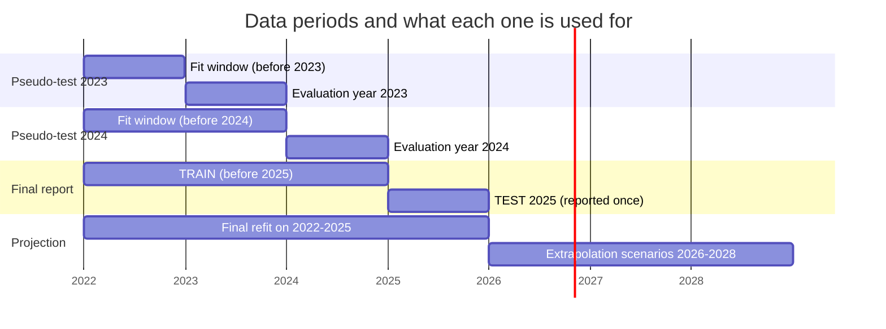
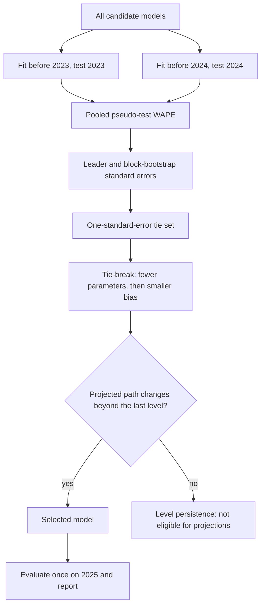
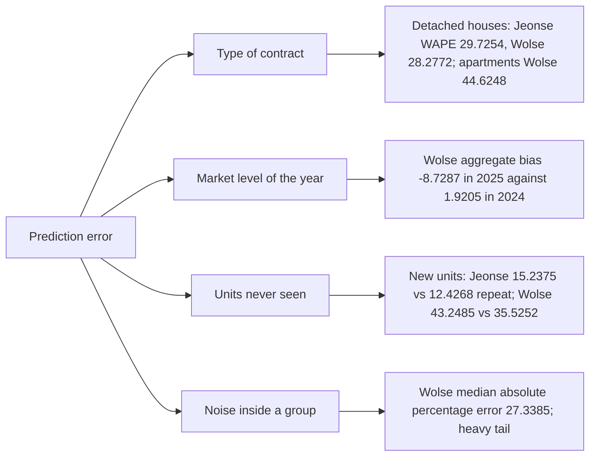

# Seoul rental market: project documentation

This document explains the project from the beginning for a reader who knows nothing about it, about Korean housing or about machine learning. It describes the repository as it is at commit `5fd0599`, including the limitations that are still open. The summary for a quick read is the [README](../README.md); the scored assessment is [reports/PROJECT_ASSESSMENT.md](../reports/PROJECT_ASSESSMENT.md); the model card is [docs/MODEL_CARD.md](MODEL_CARD.md).

Conventions: money is in units of 10,000 KRW (1,000 = 10 million KRW) unless a value is given in KRW; "Jeonse / Wolse" order is used in tables of two tracks; every number comes from `reports/metrics`, from an executed notebook, or from a command run for this document, except the hypothetical numbers of the worked example in section 6.5, which are marked as such.

## Table of contents

- [1. Executive summary](#1-executive-summary)
- [2. Background for newcomers](#2-background-for-newcomers)
  - [2.1 Jeonse and Wolse](#21-jeonse-and-wolse)
  - [2.2 Districts and neighbourhoods](#22-districts-and-neighbourhoods)
  - [2.3 Why this matters](#23-why-this-matters)
- [3. Business question and what the project can and cannot answer](#3-business-question-and-what-the-project-can-and-cannot-answer)
- [4. Data](#4-data)
  - [4.1 Source and sample design](#41-source-and-sample-design)
  - [4.2 Column dictionary](#42-column-dictionary)
  - [4.3 Cleaning log](#43-cleaning-log)
- [5. Exploratory findings](#5-exploratory-findings)
- [6. Methodology explained simply](#6-methodology-explained-simply)
  - [6.1 Two prediction tracks and the annual cash cost](#61-two-prediction-tracks-and-the-annual-cash-cost)
  - [6.2 Why a log transform, and how predictions are converted back](#62-why-a-log-transform-and-how-predictions-are-converted-back)
  - [6.3 Time-based split](#63-time-based-split)
  - [6.4 Data leakage and the feature lists](#64-data-leakage-and-the-feature-lists)
  - [6.5 Metrics in plain language](#65-metrics-in-plain-language)
  - [6.6 The selection protocol in force](#66-the-selection-protocol-in-force)
  - [6.7 Which periods were inspected during development](#67-which-periods-were-inspected-during-development)
- [7. Models](#7-models)
  - [7.1 Baselines](#71-baselines)
  - [7.2 Linear models (OLS, ridge, lasso, elastic net)](#72-linear-models-ols-ridge-lasso-elastic-net)
  - [7.3 Random forest](#73-random-forest)
  - [7.4 Histogram gradient boosting](#74-histogram-gradient-boosting)
  - [7.5 K-Means clustering](#75-k-means-clustering)
  - [7.6 Hierarchical clustering](#76-hierarchical-clustering)
  - [7.7 Gaussian mixture](#77-gaussian-mixture)
  - [7.8 Why unsupervised methods cannot predict on their own](#78-why-unsupervised-methods-cannot-predict-on-their-own)
  - [7.9 Time-series forecast of a quality-adjusted price index](#79-time-series-forecast-of-a-quality-adjusted-price-index)
  - [7.10 Hybrid index model](#710-hybrid-index-model)
  - [7.11 Later additions in the repository](#711-later-additions-in-the-repository)
  - [7.12 Renewal-only study (a separate product)](#712-renewal-only-study-a-separate-product)
- [8. Results](#8-results)
  - [8.1 Leaderboards](#81-leaderboards)
  - [8.2 The winner and why](#82-the-winner-and-why)
  - [8.3 Supervised versus unsupervised](#83-supervised-versus-unsupervised)
  - [8.4 Error decomposition](#84-error-decomposition)
  - [8.5 Error by segment](#85-error-by-segment)
  - [8.6 Uncertainty](#86-uncertainty)
  - [8.7 Robustness of the ranking](#87-robustness-of-the-ranking)
  - [8.8 What drives the error](#88-what-drives-the-error)
- [9. Projections 2026-2028](#9-projections-2026-2028)
  - [9.1 How the projections are built](#91-how-the-projections-are-built)
  - [9.2 Assumptions of the scenario table](#92-assumptions-of-the-scenario-table)
  - [9.3 The scenario table](#93-the-scenario-table)
  - [9.4 Why these are extrapolation scenarios and not forecasts](#94-why-these-are-extrapolation-scenarios-and-not-forecasts)
- [10. Limitations and risks](#10-limitations-and-risks)
- [11. Decisions log](#11-decisions-log)
- [12. How to reproduce](#12-how-to-reproduce)
- [13. Repository map](#13-repository-map)
- [14. Glossary](#14-glossary)
- [15. FAQ for non-experts](#15-faq-for-non-experts)
- [16. Appendix](#16-appendix)
  - [16.1 Metric formulas](#161-metric-formulas)
  - [16.2 Hyperparameters of the chosen models](#162-hyperparameters-of-the-chosen-models)
  - [16.3 Reports and figures](#163-reports-and-figures)

## 1. Executive summary

**The question.** How much does a tenant pay for a rental home in Seoul, and how will that change over the next few years? The answer depends on the contract type. A *Jeonse* (전세) contract asks for one large deposit and no monthly rent; a *Wolse* (월세) contract asks for a smaller deposit plus a monthly rent. The project therefore predicts two different quantities: the deposit of Jeonse contracts and the monthly rent of Wolse contracts.

**The data.** A sample of 400,000 rental contracts registered from 2022 to 2025, published by the Seoul Open Data Plaza (dataset OA-21276), with about 100,000 records per year. The sample is not proportional to the market, so the number of contracts in a month is not market volume. After documented cleaning, 387,326 contracts remain: 176,783 Jeonse and 210,543 Wolse.

**The approach.** 44 models were compared for each contract type (88 runs, 84 of them valid; the other 4 are oracle diagnostics that use test information). The models range from naive group medians to gradient boosting, clustering, a quality-adjusted price index and a hybrid of the two. Models were trained on 2022-2024 and judged on 2025, and the final choice was made on earlier pseudo-test years so that the 2025 results could be reported once, after the choice.

**The result.** The chosen models are `hgb_detrended_ld_median_recal` for Jeonse (2025 WAPE 14.14%) and `hgb_detrended_ld_median` for Wolse (2025 WAPE 40.80%). WAPE is the total absolute error divided by the total price (section 6.5). For comparison, the best naive group median has a WAPE of 27.25% (Jeonse) and 46.96% (Wolse), and the best linear model 23.09% and 49.10%. The Jeonse error is moderate. The Wolse error is large: half of the Wolse contracts are predicted within 27.34% (the median absolute percentage error), and the percentage errors are heavy-tailed (the median of the mean absolute percentage error by district and quarter is 86.81%).

**The main limitation.** Only 48 months of data exist, the sample is not proportional, and there are no macroeconomic variables. All 2026-2028 numbers are therefore extrapolation scenarios, not forecasts. For one contract, conformal intervals cover 0.8186 (Jeonse) and 0.8095 (Wolse) of the 2025 contracts at the 80% level, but not evenly across groups (Jeonse detached houses: 0.5582).

**How to read the projections.** A scenario has a base path and a low-high band. The band reflects only the uncertainty of the general price level (an interval of a price index forecast), not the dispersion of individual contracts and not the uncertainty of the model's own trend. The Jeonse base path rises at the model trend of 8.17% per year while its band comes from a flat index forecast, so the Jeonse base is an upper-trend scenario (section 9).

**Disclosure.** The 2025 results were inspected during earlier iterations of the project, so they are not those of an untouched hold-out. The final selection used only pseudo-tests on 2023 and 2024 (section 6.7).

## 2. Background for newcomers

### 2.1 Jeonse and Wolse

Korean rentals use two main contract forms.

- **Jeonse (전세).** The tenant pays one large lump-sum deposit (보증금, *bojeunggeum*) to the landlord and pays no monthly rent. The deposit is returned at the end of the lease. The cost to the tenant is therefore not the deposit itself but what the money could have earned elsewhere.
- **Wolse (월세, "monthly rent").** The tenant pays a smaller deposit and a monthly rent for the whole lease.

In the dataset, money is stored in units of 10,000 KRW (one *man-won*). A deposit of 16,000 means 160,000,000 KRW. A worked example with typical values from the data (Notebook.ipynb, section 9, finding 10): the median Jeonse deposit rose to 35,500 units, which is 355,000,000 KRW, and the median Wolse rent rose to 55 units, which is 550,000 KRW per month. Because the two forms are not directly comparable, the project uses the **annual cash cost**: for Jeonse it is the deposit (a stock of money that comes back), and for Wolse it is 12 times the monthly rent (55 units x 12 = 660 units, 6,600,000 KRW per year). The Wolse deposit is a separate, smaller sum and is excluded from the annual cash cost; the median deposits within Wolse by building type are 10,000, 4,500, 1,000 and 1,000 units (Notebook.ipynb, section 9, finding 6).

### 2.2 Districts and neighbourhoods

Seoul is divided into 25 *gu* (구, districts), for example Gangnam-gu and Mapo-gu. Each district contains many *dong* (동, neighbourhoods). The dataset records the district and the legal neighbourhood (법정동, *beopjeong-dong*) of each contract. Neighbourhood names in the file are an automatic romanization of the Korean names, and a neighbourhood name is only unique together with its district. Depending on the training window, the data contain between 367 and 393 distinct district-neighbourhood combinations (notebooks/11, block 1).

### 2.3 Why this matters

For people who live in Seoul, the deposit or the rent is the largest housing cost, and it differs a great deal by district, building type and size: the median Jeonse deposit of Gangnam-gu is 54,600 units and that of the cheapest district, Gangbuk-gu, is 18,000 (Notebook.ipynb, section 9, finding 5). For foreign residents and students the options concentrate in a few areas: the median Wolse rent in Itaewon is 100 units against 53 in the rest of Seoul, while Hongdae (60) and Sinchon (55) are above the rest of Seoul with much smaller units (finding 12). A transparent description of what drives prices, with an honest statement of the error, helps a reader judge a quoted price.

## 3. Business question and what the project can and cannot answer

The business question is: *how much will a tenant pay in Seoul in the coming years, by contract type, district, building type and size?*

**What the project can answer.**

- A typical (median-like) deposit or monthly rent for a described contract, with a measured error level (WAPE, bias, segment errors) based on 2025 contracts that the models had not seen.
- Which factors matter most (district, building type, size, neighbourhood) and which do not add information (cluster labels, section 8.3).
- Scenarios for 2026-2028 for six example profiles, with a band for the uncertainty of the general price level.
- A prediction interval for a single contract (a range that should contain the actual price with a stated frequency), with measured coverage.
- A separate study of renewals, where the previous price is known (section 7.12).

**What the project cannot answer.**

- The price of a specific dwelling: the data have no building identifier for most rows, and the unit of analysis is a contract in a sample.
- A forecast of 2026-2028: only 48 months are available and there are no macroeconomic drivers, so the projections are extrapolation scenarios.
- Market volume or the number of contracts: the sample is not proportional to the market.
- Legal or financial decisions about an individual lease (section 15).

## 4. Data

### 4.1 Source and sample design

- **Source.** Seoul Open Data Plaza, "Seoul Real Estate Jeonse and Monthly Rent Price Information", dataset OA-21276 (<https://data.seoul.go.kr/dataList/OA-21276/S/1/datasetView.do>). The terms of use are not restated in this repository; check them on the source page before reusing the data.
- **Time span.** Contracts registered from 2022 to 2025 (the file year is `registration_year`; the contract date is a separate column).
- **Size.** 400,000 rows and 23 columns before cleaning; 387,326 rows after cleaning (96.83% retained). The file is the project's own sample: the yearly source files were merged and about 100,000 records per year were sampled. The preparation script is not included in the repository (Notebook.ipynb, introduction), so the sampling cannot be reproduced.
- **Not proportional.** Because every year contributes about 100,000 records, counts per month, year or district are **not market volume** and are not comparable across years. Only prices and relationships are interpreted, never counts.
- **Inferred contract type.** `lease_type` was inferred from `monthly_rent == 0` in 2022, 2024 and 2025; only 2023 keeps the original value. In 2023 the inference matches the original label in 99.96% of the rows.

### 4.2 Column dictionary

Table 1. The 23 columns of the file plus the two columns created by the cleaning code. Money columns are in units of 10,000 KRW. "Feature" says whether the main models use the column (yes, no, or indirectly) and why.

| Column | Meaning | Unit / type | Notes | Feature |
|---|---|---|---|---|
| `registration_year` | Year the contract was registered (the file year) | integer | Not the contract year; a few rows are 2021 | No: forbidden, contract time comes from the contract date |
| `district_code` | Code of the district (gu) | 5-digit code | Redundant with the district name | No: redundant |
| `district_name` | District name in English | 25 categories | Recovered from the code | Yes |
| `legal_dong_code` | Code of the legal neighbourhood | code | Only unique together with the district | No: forbidden |
| `legal_dong_name` | Neighbourhood name, romanized | text | Automatic romanization; blank for a few unmapped codes (filled with "Unknown") | Indirectly: combined with the district as the grouped neighbourhood feature of the neighbourhood-aware models |
| `lot_type_code`, `lot_type` | Type of land lot (1, 2 or 3) | code, text | Blank for detached and multi-household houses | No: forbidden |
| `main_lot_number`, `sub_lot_number` | Main and sub lot number of the address | numbers | Dropped by the cleaning; read back only for the unit key of a diagnostic | No: forbidden |
| `floor` | Floor of the unit | integer | Negative means basement; blank when not reported (mostly detached houses) | Yes, with a "missing" flag |
| `contract_date` | Date the contract was signed | date | Format yyyy-mm-dd | Indirectly: month of the year and a time index; the raw date is forbidden |
| `lease_type` | Jeonse (deposit only) or Monthly rent | 2 categories | Inferred in three of four years | No: it defines the two tracks |
| `leased_area_sqm` | Leased area | m2, decimal text with a comma in the raw file | Converted to a number | Yes, as `log_area` |
| `deposit_10k_krw` | Deposit | 10,000 KRW | Example: 16,000 = 160,000,000 KRW | Target of the Jeonse track; never a feature of the Wolse track |
| `monthly_rent_10k_krw` | Monthly rent | 10,000 KRW | 0 for Jeonse | Target of the Wolse track; forbidden elsewhere |
| `building_name` | Building name (Korean) | text | Only available for 2023 rows; dropped | No |
| `year_built` | Year the building was built | integer | Missing rows are dropped; invalid values are removed | Yes, as `building_age` = max(contract year - year built, 0) |
| `building_type` | Apartment, Officetel, Row house / Villa (multi-unit), Detached / Multi-household house | 4 categories | Recovered in all years | Yes |
| `contract_period` | Lease term as YY.MM~YY.MM | text | Example: 22.01~24.01 | No: forbidden |
| `contract_type` | New or Renewal | 3 categories (blank becomes "Not specified") | | Yes |
| `renewal_right_used` | Whether the tenant used the renewal-request right | Yes or "No/Not reported" | | Yes |
| `previous_deposit_10k_krw`, `previous_monthly_rent_10k_krw` | Deposit and rent of the previous contract (renewals only) | 10,000 KRW | Gross errors exist (section 7.12) | No: forbidden for the main models; used only in the isolated renewal-only study |
| `contract_month` | First day of the contract month | date (created) | Used for time analysis | Not a feature |
| `floor_reported` | Whether the floor was reported | boolean (created) | | Not a feature |

### 4.3 Cleaning log

Table 2. Row-level log of the cleaning (the code is `src/rent_model/data.py`, the notebook is [Notebook.ipynb](../Notebook.ipynb), section 4). Only impossible values are removed; price and area outliers are real market values and are kept.

| Step | Reason | Rows affected | Rows left |
|---|---|---:|---:|
| Raw file | | | 400,000 |
| Exact duplicate rows | The same row twice | 10 dropped | 399,990 |
| Missing `year_built` | Cannot build the building age | 12,648 dropped (derived: 399,990 - 387,342; 12,650 rows have the value missing in the raw file) | 387,342 |
| Partial month | Contracts dated 2026-01-01 or later (an incomplete month) | 11 dropped | 387,331 |
| Impossible `year_built` | Values 1006 (3 rows) and 7811 (1 row); the valid range is 1850 to 2026 | 4 dropped | 387,327 |
| Impossible `floor` | One row with floor 302 (above 100) | 1 dropped | 387,326 |
| Total | | 12,674 dropped (3.17%) | 387,326 (96.83%) |

Missing text values are filled, not dropped (neighbourhood "Unknown", contract type "Not specified", renewal right "No/Not reported"), and `floor` keeps its missing values. The loss is not uniform: 89.32% of the detached and multi-household houses are retained (89,434 of 100,130), against 96.31% to 99.97% for the other building types, and 92.66% of the 2024 rows against 98.05% to 98.38% for the other years (Notebook.ipynb, section 10).

**Duplicates that remain.** After the cleaning, 24 exact duplicate rows remain (0.0062% of the rows). The cleaning removes exact duplicates first and only then drops `building_name` and the lot numbers, so rows that differ only in those columns become identical afterwards. With the lot numbers kept, 0 exact duplicates remain. They are kept (notebooks/00, section "Exact duplicate rows remaining").

**Split of the cleaned rows.** 176,783 Jeonse rows (training 138,848, test 37,935) and 210,543 Wolse rows (training 152,714, test 57,829).

## 5. Exploratory findings

The exploratory analysis is [Notebook.ipynb](../Notebook.ipynb) (162 cells; sections 5 to 9). Medians are used for skewed variables and Jeonse and Wolse are compared separately, because pooled deposits mix the two contract types. Table 3 lists the findings that matter most for the modeling, with the evidence and where to find it.

Table 3. Main exploratory findings. Prices are in units of 10,000 KRW. "Finding n" refers to the numbered list of Notebook.ipynb, section 9.

| # | Finding | Evidence | Where |
|---:|---|---|---|
| 1 | The sample covers all 25 districts without extreme dominance, and the two contract types are fairly balanced | Songpa-gu 8.35%, Gangseo-gu 6.92%, Gangnam-gu 6.45%; smallest Jongno-gu 1.31% and Jung-gu 1.44%; 54.36% Monthly rent against 45.64% Jeonse | Findings 1 and 2; section 3 (categorical checks) |
| 2 | District rankings must be read per contract type | Pooled medians mix contract types; within Jeonse the cheapest districts are Gangbuk-gu (18,000), Gwanak-gu (20,500) and Geumcheon-gu (20,625); Gangnam-gu and Seocho-gu are the most expensive in both markets (Jeonse medians 54,600 and 52,500, which are 3.03 and 2.92 times the cheapest district) | Findings 4 and 5; section 6, district comparisons |
| 3 | Building type is a strong price driver | Median Jeonse deposits 50,000 (Apartment), 22,000 (Row house / Villa), 21,000 (Officetel), 12,000 (Detached / Multi-household house); Wolse deposits 10,000, 4,500, 1,000 and 1,000 | Finding 6; section 6, deposit versus building type |
| 4 | Area is the main numeric driver, but variance grows with area | Spearman correlation with deposit 0.647 overall, 0.749 within Jeonse and 0.547 within Wolse; the scatter has a fan shape, which supports a log transformation | Finding 7; sections 6 and 7 |
| 5 | In Wolse, deposit and monthly rent are practically uncorrelated | Spearman 0.005; rent is associated with area (0.336) and floor (0.198) | Finding 9; section 7 |
| 6 | Part of the apparent price rise is a change in the mix of the sample | Median Jeonse deposit rose from 26,319 to 35,500 (+34.88%) while the median area rose from 50.68 to 59.86 sqm (+18.11%); per sqm the increase is +9.50%. Median Wolse rent rose from 50 to 55 (+10.00%). The quality-adjusted index (notebooks/07) ends 2025 at 103.96 (Jeonse) and 95.28 (Wolse) while the raw monthly median rebased reaches 142.58 and 110.00 | Finding 10; section 8; [notebooks/07](../notebooks/07_price_index_forecasting.ipynb) |
| 7 | Contract activity peaks at the start of each year | Peaks in February 2022, February 2023, January 2024 and February 2025, consistent with the winter-spring moving season; counts are indicative only because of the sampling | Finding 11; section 8 |
| 8 | Foreigner- and student-oriented areas differ in rent and unit size | Itaewon median Wolse rent 100 against 53 in the rest of Seoul with larger units (51.9 against 34.6 sqm); Hongdae 60 and Sinchon 55 with much smaller units (29.6 and 20.0 sqm); officetels are scarce there (13.0%, 5.5% and 0.2%) | Findings 12 and 13; section 8 |

Two data-quality observations also shape the modeling. Floor and construction year add little linear signal (Spearman 0.192 and 0.072 with deposit), and a possible area inconsistency exists in multi-household houses (86.90% of the 435 rows with an area above 130 sqm and a deposit below 1,000 are detached or multi-household houses), so no rows were removed but the area of those houses should be read with care (Notebook.ipynb, sections 9 and 10).

## 6. Methodology explained simply

### 6.1 Two prediction tracks and the annual cash cost

A *prediction track* is one prediction problem with its own target. The **Jeonse track** predicts the deposit (`deposit_10k_krw`) of Jeonse contracts. The **Wolse track** predicts the monthly rent (`monthly_rent_10k_krw`) of Wolse contracts. They are separate because the two quantities are different things: pooling them would mix large deposits with small ones, and within Wolse the deposit and the rent are practically uncorrelated (Spearman 0.005, section 5). The **annual cash cost** compares the tracks on one scale: the deposit for Jeonse, 12 times the monthly rent for Wolse. The Wolse deposit is not part of it.

### 6.2 Why a log transform, and how predictions are converted back

Prices are right-skewed: a few very expensive contracts stretch the scale, and the spread of the price grows with the size of the home (the fan shape in section 5). The models therefore predict `log1p(price)`, the natural logarithm of one plus the price, which turns multiplicative differences into additive ones and makes the spread more even. On the training years the skewness of the Wolse rent is 7.2529 on the original scale and -0.4006 on the log scale; for the Jeonse deposit it is 2.9072 and -0.1528 (notebooks/10, block e). A prediction is converted back with `expm1`, the inverse of `log1p`.

The log scale has one subtlety. A model that minimizes squared error on the log scale estimates something close to a geometric mean, which lies below the median when the log price is left-skewed, and WAPE rewards the median. The project therefore also trains models with a *median loss* (the model minimizes the absolute error on the log scale, `quantile = 0.5`). In Wolse the median loss lowers the 2025 WAPE of the detrended boosting model by 3.0454 points once the neighbourhood is included (notebooks/11, 2025 report); in Jeonse the change is -0.0159 points.

### 6.3 Time-based split

The models are evaluated on a **later period than the one they learn from**, because the real use is to predict prices that have not happened yet. A *random split* would put contracts from every month in both the learning and the test sets: the model would see the price level of 2025 while learning and look better than it will be on a genuinely new period. Table 1 and Figure 1 show the periods.

Table 1. Periods used. The "fit window" is the data a model may learn from; the "evaluation" is the period on which it is judged.

| Purpose | Fit window | Evaluation |
|---|---|---|
| Pseudo-test 2023 (selection) | rows before 2023-01-01 | contracts of 2023 |
| Pseudo-test 2024 (selection) | rows before 2024-01-01 | contracts of 2024 |
| Final report | TRAIN: 2022-01-01 to 2024-12-31 (138,848 Jeonse and 152,714 Wolse rows) | TEST: 2025 (37,935 and 57,829 rows), evaluated once |
| Scenarios 2026-2028 | all rows 2022-2025 (refit) | none: extrapolation |



Figure 1. Time periods of the protocol. Everything (grouping of neighbourhoods, encodings, hyperparameters, scale factors) is learned inside the fit window of each row of the figure.

### 6.4 Data leakage and the feature lists

**Data leakage** means that information that would not exist at prediction time reaches the model, so that the measured error is better than the real one. The protocol (`CLAUDE.md`, "Modeling protocol") forbids the following features, and tests check that they are absent (`tests/test_features.py`, `tests/test_renewal.py`).

Table 2. Forbidden features and the reason for each.

| Forbidden feature | Reason |
|---|---|
| `lease_type` within a track | It defines the track; keeping it would only separate zero rents from positive ones |
| The other track's target; the deposit in the Wolse track | Deposit and rent are set in the same negotiation; using one to predict the other would answer a different question |
| `monthly_rent` | It is 0 for every Jeonse contract and is the Wolse target |
| Every `previous_*` column | The previous price exists only for renewals and almost equals the new price (notebooks/13: carry-forward alone gives a 2025 WAPE of 6.1813% for Jeonse renewals); it is used only in the isolated renewal study |
| `contract_period`, `contract_start`, `contract_end` | Lease-term information, missing for many rows (55,451 and 51,748 rows for start and end) |
| `registration_year` | The file year, not the contract year |
| Raw `contract_date` | A raw date lets a flexible model memorize periods; only the month of the year and a time index (for trend removal) are allowed |
| `legal_dong_code`, lot-number columns | Near identifiers of buildings; a model could memorize them, and a share of the test contracts are units already seen in training (36.7128% of the 2025 Jeonse rows by an approximate unit key, notebooks/11) |
| Zone columns and `row_id` | Identifiers |

**Features used.** `district_name`, `building_type`, `contract_type`, `renewal_right_used`, `log_area` (the log of the area), `floor` (with a missing flag), `building_age` (contract year minus year built, at least 0), the month of the year, a time index `t` (months since 2022-01) only in the models that handle time, and optionally the neighbourhood (`legal_dong` within the district). Anything learned from data (the grouping of rare neighbourhoods, encodings, scaling, clusters) is learned on the fit window only.

### 6.5 Metrics in plain language

A worked example with **hypothetical numbers (not data)**: three contracts with actual prices 100, 200 and 700 and predictions 110, 180 and 600.

- **WAPE** (weighted absolute percentage error, the primary metric): the total absolute error divided by the total actual price. The absolute errors are 10, 20 and 100, so their sum is 130; the total price is 1,000; WAPE is 13%. Large contracts weigh more, which suits a question about total money and hides poor percentage errors on cheap contracts.
- **MAE** (mean absolute error): 130 divided by 3 contracts, in the unit of the price (10,000 KRW in this project).
- **MdAPE** (median absolute percentage error): the absolute percentage errors are 10%, 10% and 14.3%; the median is 10%. Half of the contracts have an error below it.
- **Median bias:** the median of the signed percentage error ((prediction - actual) / actual). Here it is +10%, -10% and -14.3%, so the median is -10%: a tendency to underpredict.
- **Aggregate bias:** (sum of predictions - sum of actuals) / sum of actuals. The predictions add up to 890 against 1,000, so it is -11%.
- **RMSE and R2 on the log scale:** RMSE is the square root of the mean squared log error and R2 the share of the variance of the log price that the model explains. They are scale-free diagnostics of the log model.
- **MAPE by district x quarter:** the mean absolute percentage error in each cell of district and quarter, summarised by its median and maximum; it exposes cells where cheap contracts have huge percentage errors.

**Why WAPE and not accuracy.** The target is a number, not a class, so "the share of correct predictions" does not exist. A percentage of total money is the quantity a tenant, a landlord or an investor cares about, and it can be compared across tracks.

### 6.6 The selection protocol in force

The protocol in `CLAUDE.md` (rule 8, amended) is the following; Figure 2 shows it.

1. **Candidates** are compared on two **pseudo-tests**: fit on rows before 2023 and test on 2023, and fit on rows before 2024 and test on 2024. Settings are chosen by a 3-fold expanding-window time cross-validation inside each fit window (the first fold trains on the earliest months and each later fold validates on the next block of months).
2. **One-standard-error rule.** The candidate with the lowest pooled WAPE is the leader. A candidate that is within one standard error of the difference to the leader is considered tied; among tied candidates the one with fewer parameters wins, then the one with the smaller absolute aggregate bias. The standard error is the **largest of three bootstrap estimates** of the paired WAPE difference: resampling rows, whole months, or whole districts (the block bootstraps keep contracts of the same month or district together, because they are correlated).
3. **Behavioural extrapolation.** A model that projects prices must extrapolate: the annual means of its projected path for a fixed profile over 2026-2028 must change beyond the last level. Otherwise it is labelled "level persistence" and cannot be the projection model.
4. **2025** is evaluated once, for the selected models, after the choice.



Figure 2. The selection protocol. The 2025 evaluation sits at the end and does not feed back into the choice.

### 6.7 Which periods were inspected during development

The project went through iterations. Early in development the models were ranked on 2025 itself (the first protocol of `CLAUDE.md`), and the 2025 results informed the candidate families and several design choices. The protocol was then amended: selection moved to the pseudo-tests, 2025 became a report-once year, and assertions in notebooks 10 and 11 check that no 2025 row enters selection, grouping, tuning or recalibration. The amendment removes the influence of 2025 on the final choice but not on the candidate list, and the earlier models keep the settings saved by their own notebooks (tuned with folds that include 2023 and 2024). The 2025 figures are therefore not those of an untouched hold-out; this is stated in the README, the model card and `CLAUDE.md`.

## 7. Models

Every model below is trained once per track on the log price (section 6.2) and judged on the 2025 contracts. Scores are the 2025 WAPE from [reports/metrics/leaderboard.csv](../reports/metrics/leaderboard.csv), written "Jeonse / Wolse", in percent. Each subsection follows the same template: what it is, how it works, what it needs, strengths, weaknesses, score, verdict.

### 7.1 Baselines

- **What it is.** A rule that predicts the median price of a group, with no learning beyond the median ([notebooks/01](../notebooks/01_baselines.ipynb)).
- **How it works.** `baseline_train_median` predicts one number for everyone; `baseline_district` the median of the district; `baseline_district_type` the median of the district and building type; `baseline_district_type_area` adds the area quintile (one of five equal-count size classes); `baseline_drift` shifts the group median by the change observed in the last training year.
- **What it needs.** Only the training rows.
- **Strengths.** Transparent, fast, and the reference every other model must beat.
- **Weaknesses.** No interactions beyond the groups, no time trend (except the crude drift).
- **Score.** 55.56 / 56.55 (one global number), 51.69 / 54.76 (district), 34.47 / 51.93 (district and type), 27.25 / 46.96 (district, type and area), 33.87 / 51.73 (drift).
- **Verdict.** The district x type x area baseline is strong: in Wolse it beats every linear model (best linear 49.10).

### 7.2 Linear models (OLS, ridge, lasso, elastic net)

- **What it is.** A weighted sum of the features that predicts the log price ([notebooks/02](../notebooks/02_linear_models.ipynb)).
- **How it works.** Each category becomes a 0/1 column and each number is scaled; the model learns one weight per column. Ridge, lasso and elastic net add a penalty on large weights to avoid *overfitting* (fitting noise in the training data); lasso can set weights to exactly zero. "Static" variants have no time feature, "time" variants add a linear time trend, and `ridge_time_rich` adds interactions between features.
- **What it needs.** Scaled, encoded features and a penalty strength chosen by cross-validation on the training years.
- **Strengths.** Interpretable coefficients and a trend that extrapolates (a straight line continues).
- **Weaknesses.** Prices depend on interactions (the effect of area differs by district and type) that a sum of effects cannot capture.
- **Score.** Static variants 24.37 / 49.97; time variants 24.04 to 24.05 / 51.35 to 51.40; `ridge_time_rich` 23.09 / 49.10.
- **Verdict.** Regularization barely matters (the four static models score alike); the linear family is clearly behind the tree models in Jeonse and behind the area baseline in Wolse.

### 7.3 Random forest

- **What it is.** An average of many decision trees ([notebooks/03](../notebooks/03_random_forest.ipynb)).
- **How it works.** A *decision tree* splits the data again and again on questions such as "is the area above 60 m2?" and predicts the average price in each final group; a forest averages hundreds of trees trained on random subsamples, which cancels most of their individual errors.
- **What it needs.** Encoded categories and a few settings (number of trees, depth, leaf size) tuned by time-ordered cross-validation.
- **Strengths.** Captures interactions and non-linear effects without manual design.
- **Weaknesses.** A tree predicts an average of training prices, so it cannot go beyond the training range: with a time feature it stays flat after the last training month. The "detrended" variant removes a straight-line trend first and adds it back.
- **Score.** `rf_static` 18.93 / 45.96, `rf_time` 17.91 / 46.35, `rf_detrended` 17.91 / 45.76.
- **Verdict.** A large improvement over linear models in Jeonse, a small one over the area baseline in Wolse.

### 7.4 Histogram gradient boosting

- **What it is.** An ensemble in which each new tree corrects the errors of the previous ones, in the `HistGradientBoostingRegressor` of scikit-learn ([notebooks/04](../notebooks/04_gradient_boosting.ipynb)).
- **How it works.** Trees are added one at a time, each fitted to the remaining error; a *learning rate* limits each tree's contribution; training stops early when a validation block of the latest months stops improving. Categories and missing floors are handled natively.
- **What it needs.** Settings (learning rate, number of trees, leaves, leaf size, penalty) tuned by random search with time-ordered folds.
- **Strengths.** The most accurate single family; handles missing floors and interactions.
- **Weaknesses.** Like forests it cannot extrapolate by itself; it has more settings, and a small tuning budget can leave the best setting at the edge of the grid.
- **Score.** `hgb_static` 18.59 / 45.54, `hgb_time` 17.31 / 45.74, `hgb_detrended` 17.65 / 45.33, `hgb_legal_dong` (with neighbourhood) 15.84 / 44.33.
- **Verdict.** The neighbourhood is the largest single gain of the early models; boosting is the base of the final models.

### 7.5 K-Means clustering

- **What it is.** An unsupervised method that groups contracts with similar structure (area, floor, age, building type) into k clusters ([notebooks/05](../notebooks/05_kmeans_clustering.ipynb)).
- **How it works.** It repeatedly assigns each contract to the nearest cluster centre and moves the centres to the mean of their members. Here k = 4 in both tracks, chosen on the training years only with a stability criterion (mean adjusted Rand index 0.9940 in Jeonse and 0.8411 in Wolse).
- **What it needs.** Scaled structural features of the training years; the target is never used to build clusters.
- **Strengths.** Describes market segments (cluster profile table and a two-dimensional projection in the notebook).
- **Weaknesses.** Clusters built from structure alone ignore location, the strongest driver.
- **Score.** As a predictor (`kmeans_median`: the training median of the cluster) 41.76 / 54.46. As a feature added to ridge, the WAPE changes by -0.0749 (Jeonse) and -0.3804 (Wolse) points; added to boosting, by +0.0313 and +0.0438.
- **Verdict.** Useful to describe segments, not to improve the best models.

### 7.6 Hierarchical clustering

- **What it is.** An unsupervised method that merges the most similar districts step by step into a tree and cuts it into a few tiers of districts ([notebooks/06](../notebooks/06_hierarchical_gmm.ipynb), part A).
- **How it works.** Ward linkage merges the pair of groups that increases the within-group variance the least; the number of tiers is chosen on the training years (3 in Jeonse, 4 in Wolse).
- **What it needs.** District-level summaries of the training years.
- **Strengths.** A readable ranking of districts (dendrogram and a tier map in the notebook).
- **Weaknesses.** The structure is weak: the silhouette (a cluster-quality score between -1 and 1) is at most 0.2825.
- **Score.** `ridge_time_tier` 24.04 / 51.35 (equal to `ridge_time`), `hgb_time_tier` 17.35 / 45.74.
- **Verdict.** No predictive value beyond the district itself.

### 7.7 Gaussian mixture

- **What it is.** An unsupervised probabilistic model that describes the contracts as a mixture of bell-shaped groups, giving each contract a probability of belonging to each group ([notebooks/06](../notebooks/06_hierarchical_gmm.ipynb), part B).
- **How it works.** It fits the groups by maximum likelihood; the number of components is chosen by the Bayesian information criterion (BIC) on the training years: 12 components in Jeonse and 11 in Wolse with full covariance (the minimum is at or near the edge of the grid).
- **What it needs.** Structural features of the training years; the probabilities become features.
- **Strengths.** Soft group membership carries more information than a hard label.
- **Weaknesses.** The BIC minimum at the edge of the grid means the best number of components is not firmly identified.
- **Score.** As a predictor (`gmm_median`) 37.10 / 51.87. As a feature, the WAPE of ridge changes by -0.6528 (Jeonse) and -0.8967 (Wolse) points; boosting changes only in Wolse, by -0.1777 points.
- **Verdict.** The only unsupervised feature that helps beyond the bootstrap noise, and only for the linear model.

### 7.8 Why unsupervised methods cannot predict on their own

Clustering and mixture models have no target: they find groups of similar rows, not prices. To compare them with supervised models the project uses them in two ways. **As a predictor:** each contract is assigned to a training cluster and receives the training median price of that cluster (`kmeans_median`, `gmm_median`). **As a feature generator:** the cluster label, the tier or the mixture probabilities are added to a supervised model (`*_kmeans`, `*_tier`, `*_gmm`). In both cases the groups are learned on the training years only and never from the target. Pure unsupervised predictors are the weakest family (best 37.10 / 51.87), and features from them do not change which model is best (section 8.3).

### 7.9 Time-series forecast of a quality-adjusted price index

- **What it is.** A price index that follows the market level over time after removing changes in the mix of contracts, and a forecast of that index ([notebooks/07](../notebooks/07_price_index_forecasting.ipynb)).
- **How it works.** A *hedonic time-dummy* regression explains the log price by the structural features plus one coefficient per month; the exponentiated month coefficients, rebased to 100 in January 2022, are the index. Forecasts use standard methods: naive (repeat the last value), drift (continue the average change), exponential smoothing, ARIMA, seasonal ARIMA and Theta, compared by a rolling-origin test.
- **What it needs.** The month-by-month index of the training years; 48 months are very few for seasonal models.
- **Strengths.** Separates the price level from the sample mix: the index ends 2025 at 103.96 (Jeonse) and 95.28 (Wolse) while the raw median rebased reaches 142.58 and 110.00.
- **Weaknesses.** The rolling-origin comparison rests on 3 overlapping origins; the Wolse jump of 2025 (from 94.47 in 2024-12 to 100.62 in 2025-01) was not anticipated.
- **Score.** The selected forecast is naive for Jeonse (12-month MAE 4.6899 index points) and drift for Wolse (2.7071 points). Against the oracle index, the 2025 MAPE is 2.0006% (Jeonse) and 4.9993% (Wolse).
- **Verdict.** A useful diagnostic and a component of the hybrid models; the scenarios it produces are wide and, in Wolse, do not agree on the direction.

### 7.10 Hybrid index model

- **What it is.** A structure model that does not know time, plus a forecast of the price index ([notebooks/08](../notebooks/08_hybrid_model.ipynb)).
- **How it works.** The training log price is divided by the index (`y_adj = log1p(price) - log(index / 100)`), a ridge or boosting model learns the structure of `y_adj`, and a prediction for a future month adds back the forecast index.
- **What it needs.** The training-years index and its forecast; no time feature.
- **Strengths.** Separates "what the contract is like" from "what the market level is", and extrapolates when the index forecast moves.
- **Weaknesses.** With a naive index forecast (Jeonse) the projected path is constant, which is *level persistence*; in the evaluation the loss caused by forecasting the index is small compared with the structure error.
- **Score.** `hybrid_ridge` 23.14 / 50.49, `hybrid_hgb` 17.44 / 46.14. The oracle versions, which use the index fitted with the test months and are not valid models, score 22.89 / 49.39 and 17.25 / 44.88.
- **Verdict.** Competitive with boosting with a time feature; the better the structure model, the better the hybrid.

### 7.11 Later additions in the repository

These were added after a review of the project ([reports/REVIEW_MODELING.md](../reports/REVIEW_MODELING.md)) and are described in [notebooks/10](../notebooks/10_selection_robustness.ipynb), [11](../notebooks/11_neighbourhood_trend_models.ipynb) and [12](../notebooks/12_uncertainty.ipynb).

- **Median loss** (`*_median`). The same boosting models trained with the median loss of section 6.2. A large part of the Wolse underprediction of the squared-loss models is a retransformation effect that the median loss removes: the 2025 aggregate bias of `hgb_legal_dong` is -21.6673% with squared loss and -9.5688% with median loss.
- **Neighbourhood-aware trend models** (`hgb_detrended_ld`, `hybrid_hgb_ld`, with `_median`). A grouped neighbourhood feature: a district-neighbourhood level with too few training rows goes to a district "OTHER" level, at most 254 levels, the minimum count chosen by cross-validation inside each fit window. They are tuned inside each fit window on their own target (the hybrid on `y_adj`, the detrended model on its residual), with a wider grid and 12 random-search candidates per search.
- **Recalibration** (`_recal`). One global scale factor, estimated on the last cross-validation fold of the fit window and applied to the predictions.
- **Score.** `hgb_detrended_ld` 14.75 / 43.84, `hybrid_hgb_ld` 14.45 / 44.51; with median loss `hgb_detrended_ld_median` 14.74 / 40.80 and `hybrid_hgb_ld_median` 14.23 / 41.38; recalibrated `hgb_detrended_ld_median_recal` 14.14 / 40.85 and `hybrid_hgb_ld_median_recal` 14.01 / 40.44.
- **Effect of each component on 2025** (detrended model, WAPE points; negative is better): the neighbourhood -2.8956 (Jeonse) and -1.4888 (Wolse); the median loss on top of it -0.0159 and -3.0454; the recalibration -0.6000 and +0.0564 (notebooks/11, 2025 report). The recalibration factor is unstable in Wolse because it comes from a short last fold.
- **Conformal intervals.** Section 8.6.
- **Verdict.** The neighbourhood is the main gain in Jeonse and the median loss is the main gain in Wolse. The chosen models are `hgb_detrended_ld_median_recal` (Jeonse) and `hgb_detrended_ld_median` (Wolse).

### 7.12 Renewal-only study (a separate product)

- **What it is.** A study of a different question: *what will a tenant pay on a future renewal, given the current price?* ([notebooks/13](../notebooks/13_renewal_study.ipynb)).
- **How it works.** It uses the previous contract's price, which the main protocol forbids, as an explicit, isolated exception documented in `CLAUDE.md`. Three models on renewal rows: carry-forward (new = previous), previous times the median ratio of the group (renewal right x building type), and boosting with median loss on the log ratio. Rows with a previous price that is missing, above a hard cap or implausibly far from the new price are flagged for this study only (569 Jeonse renewals and 5,582 Wolse renewals; nothing is removed from the main data).
- **What it needs.** The previous price of the same target, which is a domain assumption (the parties know the current price). The data have no date for the previous contract, so the order of dates is checked only indirectly.
- **Strengths.** Much smaller errors: the 2025 WAPE on renewals is 6.1813% / 10.5937% for the carry-forward, 3.5753% / 8.4641% for the group-median ratio and 4.1446% / 8.4031% for boosting, against 13.7347% / 44.3468% for the main winner on the same rows.
- **Weaknesses.** It does not apply to new contracts, is not part of the market projection, and the gain over the carry-forward is clear in 2025 but not in every pseudo-test window (in Jeonse 2023 the carry-forward is the best of the three).
- **Policy signal.** In Jeonse, 0.9859 of the renewals with the renewal right used have a new / previous price ratio at or below 1.05 (0.6245 without it), consistent with a 5% limit on the increase; the data do not show such a limit for the Wolse monthly rent (0.4608 at or below 1.05 with the right used).
- **Verdict.** A useful, clearly separated product whose comparison with the main winner measures the value of knowing the current price, not modeling quality.

## 8. Results

The numbers of this section come from [reports/metrics/leaderboard.csv](../reports/metrics/leaderboard.csv) (written by [notebooks/09](../notebooks/09_model_comparison_projection.ipynb)) and from the executed notebooks cited in each paragraph. The WAPE, bias and rank columns are measured on the 2025 contracts and are descriptive: they did not select the models. The pseudo-test column is the pooled 2023-2024 WAPE of the candidates that did.

### 8.1 Leaderboards

Table 1. Jeonse track (target: deposit, 10,000 KRW). The ten best of 42 valid models by 2025 WAPE, plus the best linear model and the best baseline. "Pseudo-test" is the pooled WAPE of 2023 and 2024 used for the selection; "-" means the model was not a candidate in that comparison.

| Rank | Model | Family | WAPE % | MAE (10,000 KRW) | Median bias % | Aggregate bias % | Pseudo-test WAPE % | Projected path | Note |
|---:|---|---|---:|---:|---:|---:|---:|---|---|
| 1 | `hybrid_hgb_ld_median_recal` | time-series/hybrid | 14.01 | 6,314.2 | 2.55 | 1.00 | 15.31 | level persistence |  |
| 2 | `hgb_detrended_ld_median_recal` | boosting | 14.14 | 6,371.5 | 2.35 | 1.07 | 15.09 | extrapolates | chosen |
| 3 | `hybrid_hgb_ld_median` | time-series/hybrid | 14.23 | 6,414.1 | -2.03 | -3.51 | 15.51 | level persistence |  |
| 4 | `hybrid_hgb_ld` | time-series/hybrid | 14.45 | 6,511.3 | -3.11 | -4.35 | 15.51 | level persistence |  |
| 5 | `hgb_detrended_ld_median` | boosting | 14.74 | 6,641.9 | 5.91 | 4.59 | 16.34 | extrapolates |  |
| 6 | `hgb_detrended_ld` | boosting | 14.75 | 6,649.1 | 5.27 | 4.08 | 15.70 | extrapolates |  |
| 7 | `hgb_legal_dong_median` | boosting | 15.54 | 7,003.1 | -6.36 | -7.70 | 16.60 | level persistence |  |
| 8 | `hgb_legal_dong` | boosting | 15.84 | 7,137.1 | -7.37 | -8.57 | 16.38 | level persistence |  |
| 9 | `hybrid_hgb_median` | time-series/hybrid | 17.09 | 7,702.3 | -2.15 | -3.93 | 17.95 | level persistence |  |
| 10 | `hgb_time_median` | boosting | 17.22 | 7,761.7 | -2.53 | -3.52 | 17.34 | level persistence |  |
| 23 | `ridge_time_rich` | linear | 23.09 | 10,408.8 | -8.26 | -10.61 | 23.29 | extrapolates |  |
| 35 | `baseline_district_type_area` | baseline | 27.25 | 12,282.3 | -4.76 | -10.29 | 26.36 | level persistence |  |

Table 2. Wolse track (target: monthly rent, 10,000 KRW), same layout.

| Rank | Model | Family | WAPE % | MAE (10,000 KRW) | Median bias % | Aggregate bias % | Pseudo-test WAPE % | Projected path | Note |
|---:|---|---|---:|---:|---:|---:|---:|---|---|
| 1 | `hybrid_hgb_ld_median_recal` | time-series/hybrid | 40.44 | 30.3 | 4.29 | 1.02 | 41.19 | extrapolates |  |
| 2 | `hgb_detrended_ld_median` | boosting | 40.80 | 30.6 | -5.76 | -8.73 | 39.23 | extrapolates | chosen |
| 3 | `hgb_detrended_ld_median_recal` | boosting | 40.85 | 30.6 | -6.13 | -9.09 | 39.22 | extrapolates |  |
| 4 | `hgb_legal_dong_median` | boosting | 41.31 | 31.0 | -6.49 | -9.57 | 39.75 | level persistence |  |
| 5 | `hybrid_hgb_ld_median` | time-series/hybrid | 41.38 | 31.0 | -8.79 | -11.65 | 39.83 | extrapolates |  |
| 6 | `hgb_detrended_median` | boosting | 42.48 | 31.8 | -6.10 | -10.23 | 40.18 | extrapolates |  |
| 7 | `hgb_static_median` | boosting | 42.58 | 31.9 | -6.81 | -11.03 | 40.38 | level persistence |  |
| 8 | `hgb_time_median` | boosting | 42.67 | 32.0 | -4.96 | -9.15 | 40.71 | level persistence |  |
| 9 | `hybrid_hgb_median` | time-series/hybrid | 43.05 | 32.3 | -9.58 | -13.69 | 40.72 | extrapolates |  |
| 10 | `hgb_detrended_ld` | boosting | 43.84 | 32.9 | -15.76 | -20.41 | 40.85 | extrapolates |  |
| 23 | `baseline_district_type_area` | baseline | 46.96 | 35.2 | -7.41 | -14.58 | 45.42 | level persistence |  |
| 24 | `ridge_time_rich` | linear | 49.10 | 36.8 | -20.28 | -28.97 | 46.16 | extrapolates |  |

The leaderboard has 88 runs (44 models in each of two tracks), 84 of them valid; the 4 excluded runs are oracle diagnostics that use information from the test period.

### 8.2 The winner and why

**Jeonse: `hgb_detrended_ld_median_recal`.** It leads the pooled pseudo-tests (WAPE 15.0935%) and is alone in the one-standard-error tie set: the closest model, `hybrid_hgb_ld_median_recal`, is 0.2171 points behind with a conservative standard error of 0.1952, so it is not a tie, and it is a level-persistence model (its projected path is constant). The winner extrapolates (its annual mean rises 15.0132% between 2026 and 2028 for a fixed profile), so it is chosen with and without the extrapolation requirement. Its 2025 WAPE is 14.1366%, median bias 2.3459% and aggregate bias 1.0732%. It is second on the 2025 table: the first place (`hybrid_hgb_ld_median_recal`, 14.0095%) was not preferred by the pseudo-tests and 2025 does not select.

**Wolse: `hgb_detrended_ld_median`.** On the pooled pseudo-tests `hgb_detrended_ld_median_recal` leads with 39.2218% and `hgb_detrended_ld_median` is a tie (difference 0.0073 points, standard error 0.0200), so the model with fewer parameters is selected (39.2291%). The next model, `hgb_legal_dong_median`, is 0.5236 points behind. Its 2025 WAPE is 40.7950%, median bias -5.7633% and aggregate bias -8.7287%.

**How the winners changed.** Under the first protocol (selection on the 2025 error) the choices were `hgb_legal_dong` (15.8354% and 44.3335% in 2025) and, among models that extrapolate, `hybrid_hgb` in Jeonse (17.4448%) and `hgb_detrended` in Wolse (45.3293%). After the amendments (median loss, neighbourhood, behavioural criterion, tuning inside each window) all four winners changed and the 2025 WAPE of the new choices is 14.1366% and 40.7950% (notebooks/09, "winners change" table).

### 8.3 Supervised versus unsupervised

Table 3. Best model per family and track by 2025 WAPE (percent).

| Family | Jeonse best model | Jeonse WAPE % | Wolse best model | Wolse WAPE % |
|---|---|---:|---|---:|
| boosting | `hgb_detrended_ld_median_recal` | 14.14 | `hgb_detrended_ld_median` | 40.80 |
| time-series/hybrid | `hybrid_hgb_ld_median_recal` | 14.01 | `hybrid_hgb_ld_median_recal` | 40.44 |
| unsupervised-assisted | `hgb_time_kmeans` | 17.34 | `hgb_time_gmm` | 45.56 |
| forest | `rf_time` | 17.91 | `rf_detrended` | 45.76 |
| linear | `ridge_time_rich` | 23.09 | `ridge_time_rich` | 49.10 |
| baseline | `baseline_district_type_area` | 27.25 | `baseline_district_type_area` | 46.96 |
| pure unsupervised | `gmm_median` | 37.10 | `gmm_median` | 51.87 |

Boosting and the hybrid are the best families in both tracks. The unsupervised families are behind: pure unsupervised predictors are the weakest (best 37.10 / 51.87), and unsupervised features added to a supervised model change the WAPE by little (Table 4). Cluster, tier and mixture features do not help boosting beyond the bootstrap noise, and the Gaussian mixture helps ridge by 0.6528 (Jeonse) and 0.8967 (Wolse) points.

Table 4. Change of the 2025 WAPE (points) when an unsupervised feature is added to a supervised model; negative means better.

| Model | Compared with | Jeonse WAPE change (points) | Wolse WAPE change (points) |
|---|---|---:|---:|
| `ridge_time_gmm` | `ridge_time` | -0.65 | -0.90 |
| `ridge_time_kmeans` | `ridge_time` | -0.07 | -0.38 |
| `ridge_time_tier` | `ridge_time` | -0.00 | -0.00 |
| `hgb_time_gmm` | `hgb_time` | +0.07 | -0.18 |
| `hgb_time_kmeans` | `hgb_time` | +0.03 | +0.04 |
| `hgb_time_tier` | `hgb_time` | +0.04 | +0.00 |

### 8.4 Error decomposition

Two decompositions are available in the repository. First, **structure versus index**: with the index fitted on the test months (an oracle that is not a valid model) the hybrid with boosting scores 17.2465% in Jeonse and 44.8760% in Wolse, against 17.4448% and 46.1356% with the forecast index ([notebooks/08](../notebooks/08_hybrid_model.ipynb) and notebooks/09). Knowing the true index changes little in Jeonse and more in Wolse, but in neither track does it close the gap to the best models of section 7.11, so most of the error is the structure of the contracts and not the market level. Second, **components of the final models** (section 7.11): the neighbourhood reduces the 2025 WAPE of the detrended model by 2.8956 points in Jeonse and 1.4888 in Wolse; the median loss by 0.0159 and 3.0454 on top of it; the recalibration by 0.6000 in Jeonse and increases it by 0.0564 in Wolse. Month-by-month rescaling with the actual prices of each month (a diagnostic that is not a valid forecast) lowers the pooled pseudo-test WAPE of `hgb_detrended_ld_median` from 16.3390% to 14.9745% in Jeonse but only from 39.2291% to 39.2190% in Wolse, so the Wolse error is not a level error (notebooks/11, block 5).

### 8.5 Error by segment

Table 5. 2025 error of the chosen models by building type (WAPE and median bias, percent; n = contracts). Source: notebooks/09, step 3.

| Building type | Jeonse n | Jeonse WAPE | Jeonse bias | Wolse n | Wolse WAPE | Wolse bias |
|---|---:|---:|---:|---:|---:|---:|
| Apartment | 22,645 | 13.4922 | 0.8530 | 17,911 | 44.6248 | -6.6553 |
| Detached / Multi-household house | 3,977 | 29.7254 | 12.3869 | 17,711 | 28.2772 | -4.3731 |
| Officetel | 3,369 | 10.3036 | 1.0669 | 10,300 | 38.4714 | -7.9484 |
| Row house / Villa (multi-unit) | 7,944 | 15.7165 | 5.6270 | 11,907 | 49.0842 | -3.7081 |

Other segments (notebooks/09 and 11): the bias is positive in every Jeonse group and negative in every Wolse group, and it grows in magnitude with the area in Wolse (-4.6924% for the smallest quintile to -10.7391% for the largest). The WAPE of Wolse by quarter of 2025 goes from 39.3740% to 42.2073%. By predicted-price tercile, the median absolute percentage error of the Jeonse winner is 12.9614% in the lowest tercile and 9.5280% in the highest, and that of the Wolse winner 25.3310% and 32.4710%; the mean absolute error is 3,095.2218 and 10,672.0585 (Jeonse) and 14.6990 and 55.7511 (Wolse), in units of 10,000 KRW. Contracts of units already seen in the training years (repeat units, an approximate key) are easier than new units: 2025 WAPE 12.4268% against 15.2375% in Jeonse and 35.5252% against 43.2485% in Wolse.

### 8.6 Uncertainty

Table 6. Empirical coverage of the conformal intervals of the chosen models (share of contracts whose actual price lies inside the interval) at the 80% and 95% levels. Source: [notebooks/12](../notebooks/12_uncertainty.ipynb).

| Evaluation | Jeonse 80% | Jeonse 95% | Wolse 80% | Wolse 95% |
|---|---:|---:|---:|---:|
| 2025 (primary, scaled version) | 0.8186 | 0.9595 | 0.8095 | 0.9542 |
| Pseudo-tests 2023 and 2024 (primary version) | 0.8302 | 0.9554 | 0.7794 | 0.9339 |

On 2025 the marginal coverage is close to nominal, and quarter by quarter the 80% coverage stays between 0.8039 and 0.8214 in Jeonse and between 0.7943 and 0.8164 in Wolse. It does not hold everywhere: it drops in the Wolse pseudo-test of 2024 (0.7504 at the 80% level, unscaled version) because the error scale of that year was larger than that of the calibration window, and by group it is far from nominal: Jeonse detached houses are covered 0.5582 (0.5265 for the unscaled version) and the lowest predicted-price tercile 0.7144. The intervals are wide: the median relative width of the 80% interval is 0.4905 of the prediction in Jeonse and 1.6647 in Wolse (unscaled version), so a single Wolse contract is predicted only within a range larger than the predicted rent. The scenario bands of section 9 are a different thing: they cover the uncertainty of the price level, not of one contract.

### 8.7 Robustness of the ranking

- **The row bootstrap understates uncertainty.** With whole months or districts resampled, close candidates become ties (for example the two Wolse models above, 0.0073 points apart), which is why the rule uses the largest of the three standard errors (notebooks/10, block a).
- **Resampling the 2025 rows.** Among all finalists the Jeonse winner has the lowest 2025 WAPE in all of 1,000 resamples (1.0000) and the Wolse winner too; among the extrapolating models without the chosen one, `hgb_detrended_ld_median` is best in 0.6610 of the row resamples in Jeonse (notebooks/09, stability).
- **Window sensitivity.** In the second pseudo-test window, fitting on 12 months instead of 24 is worse for every model tried (Jeonse `hgb_detrended_ld_median` 14.8427% against 14.3287%; Wolse 41.7653% against 41.0868%), so more history helps (notebooks/11, block 6).
- **Persistent bias.** The squared-loss models underpredict Wolse in every year (`hgb_legal_dong`: -15.6548%, -15.7420% and -21.6673% aggregate bias in 2023, 2024 and 2025); the chosen Wolse model has -3.6580%, 1.9205% and -8.7287%. The 2025 underprediction is larger than in the pseudo-tests, so the Wolse scenarios are probably conservative (notebooks/10, block c).

### 8.8 What drives the error



Figure 1. Main sources of error with the figure that supports each (2025 WAPE or bias, percent). The segments differ by track: in Jeonse the detached and multi-household houses are the hardest, in Wolse the apartments and row houses are the hardest and the detached houses the easiest.

## 9. Projections 2026-2028

### 9.1 How the projections are built

1. The chosen model of each track is **refit on all 2022-2025 rows** (176,783 Jeonse rows and 210,543 Wolse rows), with the settings tuned on the training years.
2. It predicts a **representative contract** for every month from 2026-01 to 2028-12. The profile is defined in section 9.2. For a model with the neighbourhood feature, the base path is the weighted median of its predictions over the neighbourhoods of the district and building type, with weights equal to the share of the contracts of 2025, so that one neighbourhood does not stand for the district.
3. The **base** path is that prediction. The **low** and **high** paths scale it by the 80% interval of a forecast of the quality-adjusted price index (the naive forecast for Jeonse, the drift forecast for Wolse; section 7.9).
4. Values are annual: for Jeonse the deposit, for Wolse 12 times the monthly rent. Units are 10,000 KRW (1,000 = 10 million KRW).

Both chosen models **extrapolate** (the annual mean of their projected path changes between 2026 and 2028: +15.0132% in Jeonse and +0.9595% in Wolse for a fixed profile), so neither is a level-persistence model. In Jeonse the model adds back a straight-line trend of 0.00654 log points per month (8.17% per year) fitted on 48 months, while the band comes from a flat index forecast (103.96 in 2025-12 and in 2028-12, 80% interval 86.83 to 124.45); the base path therefore rises through a band that is not centred on it. In Wolse the model trend is 0.00138 log points per month (1.67% per year) and the index forecast drifts down (95.28 to 91.81 in 2028-12, interval 54.45 to 154.82).

### 9.2 Assumptions of the scenario table

Table 1. Definition of the six example profiles. "Floor" and "building age" are the medians of the contracts of the district and building type; every profile uses contract type New and no renewal right. "Comparable contracts" are the 2025 contracts of the same district, building type and contract type with an area within 20% of the profile; "observed median" is their median price (10,000 KRW; Wolse is the monthly rent).

| Track | Profile | Contracts of the group (2022-2025) | Floor (median) | Building age (median) | Contract type | Comparable contracts 2025 | Observed 2025 median |
|---|---|---:|---:|---:|---|---:|---:|
| jeonse | Apartment 60 m2, Gangnam-gu | 7,619 | 8 | 24 | New | 164 | 73,000.0 |
| jeonse | Apartment 60 m2, Mapo-gu | 4,150 | 9 | 19 | New | 240 | 54,117.5 |
| jeonse | Apartment 60 m2, Nowon-gu | 7,514 | 8 | 33 | New | 419 | 28,000.0 |
| jeonse | Officetel 25 m2, Gangnam-gu | 960 | 7 | 8 | New | 44 | 24,500.0 |
| jeonse | Officetel 25 m2, Mapo-gu | 836 | 8 | 7 | New | 33 | 22,000.0 |
| jeonse | Officetel 25 m2, Nowon-gu | 73 | 7 | 18 | New | 2 | 23,500.0 |
| wolse | Apartment 60 m2, Gangnam-gu | 6,414 | 8 | 18 | New | 191 | 200.0 |
| wolse | Apartment 60 m2, Mapo-gu | 3,496 | 9 | 14 | New | 159 | 140.0 |
| wolse | Apartment 60 m2, Nowon-gu | 4,850 | 8 | 33 | New | 268 | 90.0 |
| wolse | Officetel 25 m2, Gangnam-gu | 1,621 | 7 | 9 | New | 276 | 80.0 |
| wolse | Officetel 25 m2, Mapo-gu | 2,688 | 8 | 8 | New | 235 | 73.0 |
| wolse | Officetel 25 m2, Nowon-gu | 261 | 7 | 19 | New | 29 | 58.0 |

Table 2. What each band includes and excludes.

| Band | Includes | Excludes |
|---|---|---|
| Base path | The chosen model refit on 2022-2025, extrapolated trend, weighted median over neighbourhoods | Any change of the model after 2025 |
| Low / high (index band) | The 80% interval of the index forecast (uncertainty of the price level) | Uncertainty of the model trend, parameter uncertainty and the noise of single contracts |
| Contract interval (conformal) | The dispersion of single contracts around the model, measured on the last 6 months of the fit window (2025-07-01 to 2025-12-01) | Uncertainty about the future price level and about the trend; it assumes future errors resemble those of the calibration window |

The index band and the contract interval answer different questions (the market level, one contract) and are not added.

### 9.3 The scenario table

Table 3. Jeonse deposit (10,000 KRW): 2026 and 2028 base paths with the low-high index band. "vs observed" compares the 2026 base with the observed 2025 median of the comparable contracts.

| Profile | Observed 2025 median | Comparable contracts | 2026 base (low - high) | 2026 base vs observed % | 2028 base (low - high) |
|---|---:|---:|---:|---:|---:|
| Apartment 60 m2, Gangnam-gu | 73,000.0 | 164 | 77,221.8 (71,759.5 - 83,141.4) | 5.8 | 90,353.4 (76,567.3 - 106,631.2) |
| Apartment 60 m2, Mapo-gu | 54,117.5 | 240 | 68,060.5 (63,246.2 - 73,277.9) | 25.8 | 79,634.3 (67,483.7 - 93,981.0) |
| Apartment 60 m2, Nowon-gu | 28,000.0 | 419 | 32,529.8 (30,228.8 - 35,023.5) | 16.2 | 38,061.6 (32,254.1 - 44,918.8) |
| Officetel 25 m2, Gangnam-gu | 24,500.0 | 44 | 31,598.1 (29,363.0 - 34,020.4) | 29.0 | 36,971.5 (31,330.3 - 43,632.2) |
| Officetel 25 m2, Mapo-gu | 22,000.0 | 33 | 26,232.8 (24,377.2 - 28,243.8) | 19.2 | 30,693.8 (26,010.4 - 36,223.6) |
| Officetel 25 m2, Nowon-gu | 23,500.0 | 2 | 11,419.5 (10,611.7 - 12,294.9) | -51.4 | 13,361.5 (11,322.7 - 15,768.8) |

Table 4. Wolse annual rent (12 x monthly rent, 10,000 KRW); the observed median in Table 1 is monthly.

| Profile | Observed 2025 median | Comparable contracts | 2026 base (low - high) | 2026 base vs observed % | 2028 base (low - high) |
|---|---:|---:|---:|---:|---:|
| Apartment 60 m2, Gangnam-gu | 200.0 | 191 | 2,351.1 (1,979.3 - 2,801.5) | -2.0 | 2,430.8 (1,523.7 - 3,878.9) |
| Apartment 60 m2, Mapo-gu | 140.0 | 159 | 1,870.9 (1,574.7 - 2,229.8) | 11.4 | 1,934.4 (1,211.6 - 3,088.3) |
| Apartment 60 m2, Nowon-gu | 90.0 | 268 | 1,078.2 (906.7 - 1,286.0) | -0.2 | 1,115.0 (696.5 - 1,783.1) |
| Officetel 25 m2, Gangnam-gu | 80.0 | 276 | 1,210.5 (1,018.2 - 1,443.5) | 26.1 | 1,251.7 (782.4 - 2,000.9) |
| Officetel 25 m2, Mapo-gu | 73.0 | 235 | 907.5 (762.8 - 1,082.7) | 3.6 | 938.5 (585.5 - 1,502.0) |
| Officetel 25 m2, Nowon-gu | 58.0 | 29 | 688.8 (578.6 - 822.4) | -1.0 | 712.5 (443.4 - 1,141.9) |

**Reading a row.** For the 60 m2 apartment in Gangnam-gu the Jeonse base of 2026 is 77,221.8 (about 772.2 million KRW) and the band 71,759.5 to 83,141.4. A single contract of that profile has an 80% interval of 60,656.1 to 98,311.6 and a 95% interval of 45,013.3 to 132,475.8 (10,000 KRW; [notebooks/09](../notebooks/09_model_comparison_projection.ipynb), conformal table). The Officetel of 25 m2 in Nowon-gu in Jeonse rests on only 2 comparable contracts in 2025 and its scenario (51.4% below the observed median) should not be relied on.

### 9.4 Why these are extrapolation scenarios and not forecasts

The projections extend a pattern fitted on 48 months. No macroeconomic driver (interest rates, policy, supply) enters, the trend is assumed to continue unchanged, and the Wolse model underpredicted 2025 (aggregate bias -8.7287%), so the Wolse base is probably conservative. The bands cover only the price level. A reader should treat the paths as "what the 2022-2025 pattern implies", not as a prediction of what will happen.

## 10. Limitations and risks

Table 1. Limitations, each with its consequence for the interpretation of the results.

| Limitation | Consequence |
|---|---|
| Only 48 months of data | Trends and seasonality are barely identifiable; index forecasts rest on 3 overlapping origins; the 2026-2028 results are extrapolations with wide bands, especially in Wolse |
| The sample is not proportional to the market (about 100,000 records per year) | Counts are not volume; the index only partly corrects the composition (neighbourhood and building quality are not controlled); the preparation script of the sample is not in the repository |
| No macroeconomic variables | Level shifts (for example the Wolse jump of 2025-01) cannot be anticipated; deposits depend on interest rates and policy |
| Models cannot extrapolate by themselves; the Jeonse trend is steeper than its band | Projection models need an explicit trend or index; the Jeonse base is an upper-trend scenario (section 9.1) |
| 24 exact duplicate rows remain after the cleaning | Negligible (0.0062% of the rows); they differ only in dropped columns and are kept |
| Lot numbers are missing for part of the rows | The unit key used to flag repeat units is an approximation; the main lot number is known for 88.5812% of the Jeonse and 70.7032% of the Wolse pseudo-test rows (notebooks/11, block 7) |
| WAPE weights large contracts | The mean absolute error is far larger in the highest predicted-price tercile (10,672.0585 in Jeonse, 55.7511 in Wolse) than in the lowest (3,095.2218 and 14.6990); the percentage errors are heavy-tailed (median MAPE by district and quarter of the Wolse winner 86.8146% against an MdAPE of 27.3385%) |
| The Wolse error is large and the 2025 level is underpredicted | WAPE 40.7950% and aggregate bias -8.7287% in 2025; Wolse scenarios are probably conservative |
| Small tuning budget | Each search samples 12 candidates and `max_leaf_nodes` is the largest grid value (255) in most of them; a wider search may improve the neighbourhood-aware models |
| Conformal intervals hold on average, not by group or in every year | Jeonse detached houses are covered 0.5582 at the 80% level; the Wolse pseudo-test of 2024 covers 0.7504 |
| 2025 was inspected during earlier iterations | The 2025 figures are not those of an untouched hold-out; the final selection used only the pseudo-tests |
| `lease_type` is inferred in three of four years | Inconsistent labels cannot be detected in those years |
| The previous price of renewals is a domain assumption | The renewal study does not apply to new contracts; the data have no date for the previous contract |

**Review findings still open or partly fixed** (assessment in [reports/PROJECT_ASSESSMENT.md](../reports/PROJECT_ASSESSMENT.md)): the phrase "level shift" remains in the markdown of notebooks 00, 01, 02, 03 and 07 (F-02); the earlier models and the unsupervised-assisted models still reuse saved settings and the best `max_leaf_nodes` is at the grid edge (F-10); `make install` does not use `constraints.txt` and no run of the continuous integration can be verified from the repository (F-13); there is no calibration plot or residual-over-time plot for the chosen models (F-15); the test that ties README numbers to the outputs did not catch a broken cell in the cleaning table of the README (F-18); the 61 MB CSV is tracked in git without Git LFS and the data terms of use are not restated (F-19).

## 11. Decisions log

Table 1. Main design decisions with the alternatives considered, the reason and the consequence.

| Decision | Alternatives considered | Reason | Consequence |
|---|---|---|---|
| Two tracks (Jeonse deposit, Wolse monthly rent) | One pooled model with the contract type as a feature | Pooled deposits mix contract types; deposit and rent are practically uncorrelated in Wolse (Spearman 0.005) | Two sets of results; an annual cash cost to compare |
| Target `log1p(price)` | Raw price | Right-skewed prices and a fan-shaped variance (skewness 7.2529 raw and -0.4006 log for Wolse) | Predictions are converted back with `expm1`; the squared loss estimates a geometric-mean-like value |
| Median loss (`quantile = 0.5`) | Squared loss with a smearing factor | WAPE is minimized by a median; the loss removes about half of the Wolse retransformation bias (aggregate bias of `hgb_legal_dong` in 2025: -21.6673% with squared loss, -9.5688% with median loss) | 2025 WAPE of the detrended model with neighbourhood falls by 3.0454 points in Wolse |
| Strict temporal split | Random split, k-fold | Predicting a later period; a random split leaks the price level of the future | Time-ordered folds everywhere |
| WAPE as the primary metric | MAPE, RMSE | A percentage of total money, robust to near-zero prices (MAPE explodes on cheap contracts) | Large contracts weigh more; segment errors are reported next to it |
| Forbidden features list enforced by tests | Use of every available column | Prevent leakage and identifier memorization | Features are limited to the allowed list; the renewal study is the only isolated exception |
| Selection on pseudo-tests with block bootstraps and a one-standard-error rule | Lowest 2025 WAPE with a row bootstrap | Winner's curse on the report year; correlated contracts make the row bootstrap too optimistic | 2025 is reported once; all four winners changed |
| Behavioural extrapolation criterion | Label-based (model family) | A model labelled "forecasted index" with a naive index forecast has a constant path | Jeonse hybrids are classified as level persistence and cannot be projection models |
| Grouped neighbourhood with a district "OTHER" level | Raw neighbourhood, none | Many neighbourhoods have few rows; unseen neighbourhoods must be handled | Main gain in Jeonse (2.8956 points in 2025) |
| Recalibration only where the tie-break allows it | Always recalibrate | The factor comes from a short last fold and is unstable in Wolse | Selected for Jeonse, not for Wolse |
| Conformal intervals on the log scale with a scaled and an unscaled version | Quantile boosters (the earlier interval under-covered) | Finite-sample coverage guarantee under exchangeability | Marginal coverage near nominal on 2025; not uniform by group |
| Keep price and area outliers | Remove outliers by the interquartile rule | They are real market values | Log transforms and medians are used instead |
| Keep the 24 remaining duplicate rows | Drop them after dropping columns | They are distinct records of the raw file | Disclosed in the cleaning log |
| A quality-adjusted price index | Raw monthly medians | The sample mix changes from month to month | The index and its forecast feed the hybrid models and the scenario bands |
| The renewal study is a separate product | Add the previous price to the main models | The previous price is not available for new contracts and would change the question | Separate notebook, runs marked `scope = renewal_only`, excluded from the leaderboard |
| Reuse the saved settings of the earlier models | Re-tune every model inside every window | Budget; the finalists are re-tuned | Earlier models keep settings tuned with folds that include 2023 and 2024 |

## 12. How to reproduce

**Environment.** Python 3.13.7. Install the packages with the exact versions of the run:

```bash
pip install -r requirements.txt -c constraints.txt
```

`requirements.txt` holds lower bounds and upper caps; `constraints.txt` pins the installed versions (the `make install` target runs `pip install -r requirements.txt` without the constraints file, so use the command above). The optional Streamlit explorer needs `pip install streamlit`.

**Data.** The file `data/Seoul_Rentals_2022_2025.csv` is tracked in the repository (about 61 MB; GitHub warns above 50 MB) and is never edited. It is a sample built from the yearly files of the Seoul Open Data Plaza (dataset OA-21276, <https://data.seoul.go.kr/dataList/OA-21276/S/1/datasetView.do>). The preparation script is not in the repository, so a new download does not reproduce the file exactly. Check the terms of use on the source page before reuse.

**Checks.**

```bash
python -m pyflakes src tests app     # unused imports and names; reports nothing
pytest -q                            # 198 tests
```

**Notebooks, in dependency order.** `bash scripts/run_all.sh` (or `make all`) runs the linter, the tests and the notebooks in this order; each notebook can also be run with `python -m nbconvert --to notebook --execute --inplace notebooks/<name>.ipynb`.



```mermaid
flowchart LR
    N0[00 setup] --> N1[01 baselines] --> N2[02 linear] --> N3[03 forest] --> N4[04 boosting]
    N4 --> N5[05 K-Means] --> N6[06 hierarchical and GMM] --> N7[07 price index] --> N8[08 hybrid]
    N8 --> N10[10 selection robustness] --> N11[11 neighbourhood models] --> N12[12 uncertainty]
    N12 --> N9[09 comparison and projection] --> N13[13 renewal study]
```

Figure 1. Execution order. Later notebooks read the runs saved by earlier ones: notebooks 05 and 06 read the settings of `ridge_time` and `hgb_time`; notebook 08 those of the static models; notebook 10 writes the median-loss runs and `pseudotest_*.json`; notebook 11 writes the neighbourhood-aware runs and `pseudotest_v2_*.json`; notebook 12 writes the `_conformal` runs; notebook 09 reads all of them and writes the leaderboard and the scenarios; notebook 13 reads the selection and the saved predictions of the main winners. `Notebook.ipynb` (the EDA) only needs the CSV.

**What is regenerated and what is not.**

- Re-running a notebook appends a new run to `reports/metrics/{track}__{model_id}.json`; every table reads the last run. The files `ts_index_*.json`, `pseudotest_*.json`, `pseudotest_v2_*.json` and `leaderboard.csv` are rewritten.
- `reports/predictions/` (parquet files) is generated by the notebooks and is **gitignored**, so a fresh clone must run the notebooks in order before notebook 09 can read the predictions.
- The figures of `reports/figures/` are rewritten by notebooks 00, 07, 08, 09, 10, 11 and 12.
- **Runtime.** Notebook 11 is the slow one: each of its twelve tunings takes between 529 and 963 seconds (printed in the notebook).
- **Random seed.** `RANDOM_SEED = 42`, defined only in `src/rent_model/config.py`.
- The README generator is not in the repository, so the README is not regenerated by a repository command.

**Streamlit explorer.** `streamlit run app/streamlit_app.py` refits the chosen models locally and shows the scenarios for a district, a building type and an area.

## 13. Repository map

```
Notebook.ipynb                 EDA and cleaning (English)
CLAUDE.md                      project conventions and the modeling protocol
README.md                      summary, headline answer, results
data/                          Seoul_Rentals_2022_2025.csv (never edited)
notebooks/                     00 to 13: modeling setup, models, selection, uncertainty, renewal study
src/rent_model/                the package used by the notebooks and the tests
tests/                         pytest suite (data, features, models, protocol, traceability)
reports/metrics/               one JSON per model and track, ts_index_*.json, pseudotest*.json, leaderboard.csv
reports/figures/               PNG figures
reports/REVIEW_MODELING.md     senior review of the modeling (22 findings)
reports/PROJECT_ASSESSMENT.md  scored assessment of the project and status of the findings
reports/refactor_check.csv     before/after comparison of the saved metrics after the helper refactor
docs/MODEL_CARD.md             model card
docs/PROJECT_DOCUMENTATION.md  this document
app/streamlit_app.py           optional scenario explorer
constraints.txt                exact package versions of the run
requirements.txt               package bounds
scripts/run_all.sh, Makefile   run the linter, the tests and the notebooks
.github/workflows/ci.yml       continuous integration (pyflakes and tests)
```

Modules of `src/rent_model/`: `config` (paths, split dates, features, seed), `data` (loading and cleaning), `features` (feature construction and the neighbourhood grouper), `splits`, `metrics`, `io` (saving runs), `baselines`, `linear`, `forest`, `boosting`, `clustering`, `unsupervised`, `ts_index`, `hybrid`, `recipes` (a definition of each candidate model), `pseudotest`, `compare` (leaderboard and selection), `projection`, `diagnostics`, `conformal` and `renewal` (the separate product).

Table 1. Notebook guide: purpose, what it reads and what it writes.

| Notebook | Purpose | Reads | Writes |
|---|---|---|---|
| [Notebook.ipynb](../Notebook.ipynb) | EDA and documented cleaning | the CSV | nothing (analysis) |
| [00_modeling_setup](../notebooks/00_modeling_setup.ipynb) | Protocol, temporal split, folds, duplicate check, smoke-test baseline | the cleaned data | `baseline_train_median` run, one figure |
| [01_baselines](../notebooks/01_baselines.ipynb) | Naive group baselines | the cleaned data | baseline runs |
| [02_linear_models](../notebooks/02_linear_models.ipynb) | OLS, ridge, lasso, elastic net | the cleaned data | linear runs |
| [03_random_forest](../notebooks/03_random_forest.ipynb) | Random forests | the cleaned data | `rf_*` runs |
| [04_gradient_boosting](../notebooks/04_gradient_boosting.ipynb) | Boosting, quantile intervals | the cleaned data | `hgb_*` runs |
| [05_kmeans_clustering](../notebooks/05_kmeans_clustering.ipynb) | K-Means predictor and features | runs of `ridge_time`, `hgb_time` | `kmeans_median`, `*_kmeans` runs |
| [06_hierarchical_gmm](../notebooks/06_hierarchical_gmm.ipynb) | District tiers and Gaussian mixture | runs of `ridge_time`, `hgb_time` | `*_tier`, `gmm_median`, `*_gmm` runs |
| [07_price_index_forecasting](../notebooks/07_price_index_forecasting.ipynb) | Quality-adjusted index and forecasts | the cleaned data | `ts_index_*.json`, figures |
| [08_hybrid_model](../notebooks/08_hybrid_model.ipynb) | Structure model plus forecast index | `ts_index_*.json`, static-model settings | `hybrid_*` runs (and oracle diagnostics) |
| [10_selection_robustness](../notebooks/10_selection_robustness.ipynb) | Pseudo-tests, block bootstrap, median loss, bias by year | earlier runs | `*_median` runs, `pseudotest_*.json` |
| [11_neighbourhood_trend_models](../notebooks/11_neighbourhood_trend_models.ipynb) | Neighbourhood-aware models, tuning, recalibration, learning curve, repeat units, price tiers | `pseudotest_*.json`, earlier runs | `*_ld*` runs, `pseudotest_v2_*.json`, figure |
| [12_uncertainty](../notebooks/12_uncertainty.ipynb) | Conformal intervals | `pseudotest_v2_*.json`, chosen runs | `_conformal` runs, figures |
| [09_model_comparison_projection](../notebooks/09_model_comparison_projection.ipynb) | Leaderboard, selection tables, 2026-2028 scenarios, contract-level interval | all runs and selections | `leaderboard.csv`, figures |
| [13_renewal_study](../notebooks/13_renewal_study.ipynb) | Renewal-only study (separate product) | `pseudotest_v2_*.json`, saved predictions | `renewal_*` runs |

## 14. Glossary

Table 1. Terms used in this document. Korean terms are given where the dataset or the market uses them.

| Term | Meaning |
|---|---|
| Jeonse (전세) | A lease with one large lump-sum deposit and no monthly rent; the deposit is returned at the end |
| Wolse (월세) | A lease with a smaller deposit plus a monthly rent |
| Deposit (보증금) | Money paid to the landlord at the start of the lease and, in principle, returned at the end |
| District, *gu* (구) | One of the 25 administrative districts of Seoul |
| Neighbourhood, *dong* (동) | A subdivision of a district; the data record the legal neighbourhood (법정동) |
| Unit of the data | 10,000 KRW; a value of 16,000 means 160,000,000 KRW |
| Track | One prediction problem with its own target (the Jeonse deposit or the Wolse monthly rent) |
| Annual cash cost | The deposit for Jeonse; 12 times the monthly rent for Wolse |
| Target, feature | The quantity to predict; an input used to predict it |
| Baseline | A very simple rule that every model must beat |
| Train, test | Data a model learns from; later data on which it is judged |
| Leakage | Information that would not exist at prediction time reaching the model, which makes the measured error too good |
| Overfitting | Fitting noise in the training data, which fails on new data |
| Cross-validation | Repeatedly learning on part of the data and checking on another part; in time series the checked part is always later |
| Hyperparameter | A setting chosen before training (for example the number of trees) |
| Ensemble | A model that combines many simpler models (forest, boosting) |
| Clustering | Grouping similar rows without using a target |
| Log transform | Working with the logarithm of the price so that differences are multiplicative; `log1p` is log(1 + price) |
| Median loss | Training that minimizes the absolute error, which aims at the median instead of the mean |
| WAPE | Weighted absolute percentage error: total absolute error divided by total actual price |
| MAE, MdAPE | Mean absolute error; median absolute percentage error |
| Bias, aggregate bias | Average signed error; the sum of predictions minus the sum of actuals, divided by the sum of actuals |
| Quality-adjusted (hedonic) index | A price index that holds the mix of building type, area and age fixed |
| Pseudo-test | An earlier evaluation year used for selection, with a fit window ending before it |
| Bootstrap | Resampling the data many times to measure how much a result varies |
| Block bootstrap | A bootstrap that resamples whole groups (months, districts) because rows in a group are correlated |
| One-standard-error rule | Choose the simplest model whose error is within one standard error of the best |
| Conformal interval | A prediction interval built from past errors so that, if the future resembles the calibration period, it contains the actual value with a stated frequency |
| Coverage | The share of actual values that fall inside an interval |
| Extrapolation | Predicting outside the range of the training data |
| Level persistence | A projected path that stays at its last level |
| Oracle | A diagnostic that uses information from the test period; never a valid model |
| Recalibration | Multiplying predictions by one factor estimated on a recent validation block |

## 15. FAQ for non-experts

**1. Why not just average the prices?** An average mixes Jeonse deposits with Wolse rents, is pulled up by a few expensive contracts, and ignores district, building type and size. One global median per track has a 2025 WAPE of 55.56% (Jeonse) and 56.55% (Wolse); the median of the district, building type and area class gets 27.25% and 46.96%; the chosen models get 14.14% and 40.80%.

**2. Why is Wolse harder to predict than Jeonse?** The Wolse WAPE is 40.80% against 14.14% in Jeonse. Monthly rents are set in round amounts and move in coarse steps (the median rose from 50 to 55 units), and within Wolse the deposit and the rent are practically uncorrelated (Spearman 0.005), so the same rent can come with very different deposits and the model, which does not use the deposit, cannot tell them apart. The percentage errors are also heavy-tailed (median MAPE by district and quarter 86.81% against a median absolute percentage error of 27.34%).

**3. Can this tell me what I will pay next year?** Not as a forecast. The scenarios extend a pattern fitted on 48 months. For a 60 m2 apartment in Gangnam-gu the Jeonse base of 2026 is 77,221.8 (about 772.2 million KRW) with an index band of 71,759.5 to 83,141.4, and one contract of that profile has an 80% interval of 60,656.1 to 98,311.6 (10,000 KRW).

**4. Why does the best model not use time directly?** A tree model cannot predict outside the range of the training data: with a time feature it stays flat after the last training month. The chosen models remove a straight-line trend with the month index, learn the rest, and add the trend back; the month index is used only for that. Boosting with a plain time feature (`hgb_time`) scores 17.31% / 45.74% and its projected path is flat.

**5. What does an error of X% mean in KRW for a typical contract?** The mean absolute error of the Jeonse winner is 6,371.4772 in units of 10,000 KRW, about 63.7 million KRW, for a median deposit of 35,500 units (355,000,000 KRW). For the Wolse winner it is 30.5817 units, about 305,817 KRW per month, for a median rent of 55 units (550,000 KRW). Half of the contracts have an error below 10.6978% (Jeonse) and 27.3385% (Wolse).

**6. Can the model be used to decide on a lease?** No. The data are a sample of contracts, most rows have no building identifier, and the errors are substantial: a single Wolse contract is predicted only within a range wider than the predicted rent (median relative width of the 80% interval 1.6647 of the prediction). A lease decision needs the actual terms, the building and legal advice.

**7. Why are unsupervised methods in the project if they do not win?** To describe market segments and to test whether cluster labels add predictive information. They do not: unsupervised features change the WAPE of boosting by at most 0.1777 points in Wolse and add nothing in Jeonse (section 8.3).

**8. How do we know the 2025 results were not tuned?** The selection used pseudo-tests on 2023 and 2024, and assertions in notebooks 10 and 11 check that no 2025 row enters selection, grouping, tuning or recalibration. However, 2025 was inspected in earlier iterations of the project, so the candidate list and the saved settings of the earlier models carry that influence; this is disclosed (section 6.7).

**9. What is a conformal interval and can it be trusted?** It is a range built from past errors so that, if the future resembles the calibration period, it contains the actual price about 80% (or 95%) of the time. On 2025 it covers 0.8186 (Jeonse) and 0.8095 (Wolse) at the 80% level. It cannot be trusted equally everywhere: Jeonse detached houses are covered only 0.5582, and in one pseudo-test year (Wolse 2024) coverage fell to 0.7504.

**10. Why does the Jeonse projection rise so much?** The model adds back a straight-line trend of 8.17% per year fitted on 48 months, while the band comes from a flat index forecast. The base path is therefore an upper-trend scenario that rises through its band; it is not a prediction of 8.17% yearly growth.

**11. What is the difference between the index band and the contract interval?** The band describes the uncertainty of the general price level; the contract interval describes how far one contract can be from the model. They answer different questions and are not added.

**12. Why is a renewal easier to predict?** Because the current price is known: carrying it forward gives a 2025 WAPE of 6.1813% (Jeonse) and 10.5937% (Wolse) on renewals, and a model that multiplies it by the median ratio of the group gets 3.5753% and 8.4641%. This is a separate product that does not apply to new contracts.

## 16. Appendix

### 16.1 Metric formulas

With actual prices y_i, predictions p_i and n contracts:

- WAPE = 100 x sum |y_i - p_i| / sum |y_i|
- MAE = (1/n) x sum |y_i - p_i|
- MdAPE = 100 x median of |y_i - p_i| / |y_i|
- Median bias = 100 x median of (p_i - y_i) / y_i
- Aggregate bias = 100 x (sum p_i - sum y_i) / sum y_i
- RMSE (log) = square root of the mean of (log(1 + y_i) - log(1 + p_i))^2; R2 (log) = 1 - SSE / SST on the same scale
- Conformal radius for a level L from n calibration scores: the ceil((n + 1) x L)-th smallest score; interval = expm1(log1p(p) -/+ radius), clipped at zero

### 16.2 Hyperparameters of the chosen models

Table 1. Settings and metadata saved with the final run of each chosen model (`reports/metrics/{track}__{model_id}.json`). Both were selected by random search with a 3-fold expanding-window time cross-validation inside the fit window (12 candidates).

| Item | Jeonse: `hgb_detrended_ld_median_recal` | Wolse: `hgb_detrended_ld_median` |
|---|---|---|
| Loss | quantile 0.5 on `log1p` | quantile 0.5 on `log1p` |
| `learning_rate` | 0.05 | 0.05 |
| `max_iter` (upper cap; early stopping decides) | 300 | 300 |
| `max_leaf_nodes` | 255 | 255 |
| `min_samples_leaf` | 20 | 20 |
| `l2_regularization` | 0.0 | 0.0 |
| `min_frequency` (rows needed for a neighbourhood level) | 30 | 30 |
| Recalibration factor (final fit) | 0.9664 | none |
| Behaviour of the projected path | extrapolates | extrapolates |
| Pseudo-test WAPE 2023 and 2024 (percent) | 15.8080 and 14.3281 | 37.4050 and 41.0868 |

### 16.3 Reports and figures

- `reports/metrics/leaderboard.csv`: one row per model and track with the metrics, the pseudo-test WAPE, the ranks and the selection flags.
- `reports/metrics/{track}__{model_id}.json`: the runs of one model (metrics and metadata; the last run is read).
- `reports/metrics/ts_index_{track}.json`: the price index, its forecasts and the scenarios.
- `reports/metrics/pseudotest_{track}.json` and `pseudotest_v2_{track}.json`: the selection tables of notebooks 10 and 11.
- `reports/figures/`: `00_monthly_median_target.png`, `07_price_index.png`, `07_forecast_2025.png`, `07_scenarios_2026_2028.png`, `08_hybrid_monthly_2025.png`, `09_leaderboard.png`, `09_projection_scenarios.png`, `10_bias_by_year.png`, `11_component_effects.png`, `12_coverage_by_group.png`, `12_interval_width.png`.
- `reports/refactor_check.csv`: before/after comparison of the saved metrics after the helpers were moved to `src/rent_model`.
- `reports/REVIEW_MODELING.md` and `reports/PROJECT_ASSESSMENT.md`: the review and the scored assessment.
